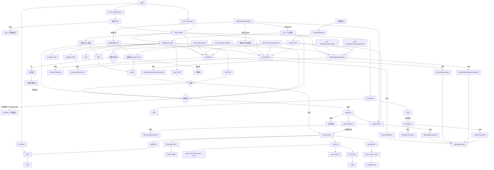

# Agent Workbench

基于 Next.js 16 构建的 AI 助手应用，集成了多轮对话、Agent 工具调用与 RAG 知识库检索能力。

## 功能特性

- **对话聊天**：支持多会话管理的流式对话（`src/app/api/chat`、`ChatSidebar`）。
- **Agent 工具调用**：基于工具注册表的 Agent 循环（`src/lib/agent`）。
- **RAG 知识库**：文档上传、分块、向量化、索引与相似度检索的完整流程（`src/lib/rag`、`src/app/knowledge`）。
- **模型接入**：对话模型与 Embedding 模型通过环境变量配置，默认对接百度千帆（Qianfan）。
- **MCP 与 Skills**：本地工具和文件系统 MCP 走同一套解析；技能从 `.agent/skills` 加载。
- **Coding Agent**：`writeFile` 和 `runCommand` 必须先经过人工审批。
- **Trace**：任务结束后仍可查看步骤、工具、审批和指标。设置 `AGENT_TRACE_STORE=sqlite` 后，每条事件追加进 `agent_trace_events`，步骤是从事件推导的；重启后的恢复事件接在同一条 Trace 上。
- **清理**：默认关闭。设 `AGENT_PERSISTENCE_CLEANUP_ENABLED=true` 后，进程启动时用带过期时间的租约锁清理超过 `AGENT_PERSISTENCE_TTL_DAYS`（默认 7 天）的终态数据。正在跑或等待审批的记录会留下。
- **持久化诊断**：`GET /api/agent/persistence/health` 只读检查五个存储是否可用，并带上 schema 版本、清理锁是否被持有、以及当前进程的计数。只返回数据库文件名，不返回密钥或完整路径。
- **Workflow**：提交节点和边，校验为有向无环图后在任务里执行。设置 `AGENT_WORKFLOW_EXECUTION_STORE=sqlite` 后，执行状态和每个节点写入同一个 SQLite。工具节点从下一节点继续；Agent 节点复用 Session，批准后继续该节点的循环，答完再往下走。已完成的节点不重跑。
- **Git**：只读查看 status、diff、log、branch 和 show；`gitAdd`、`gitCommit` 与 `gitPush` 必须先过前置校验，再等人批准。推送只允许 `origin`，不能 force push。
- **GitHub**：只读查看配置仓库的信息、Issue 和 Pull Request；不能创建、修改或合并。
- **Task Persistence**：任务的创建、状态和事件都经过 `TaskStore`。默认仍是进程内内存；设置 `AGENT_TASK_STORE=sqlite` 后写入 `.data/agent.sqlite`。重启时 `running` 收成 failed，不重新执行。
- **Approval**：审批状态可单独持久化（`AGENT_APPROVAL_STORE=sqlite`，与任务同一个库）。有未决审批时，重启后任务保持等待。
- **Session**：每个任务有一份对话历史（`AGENT_SESSION_STORE=sqlite`）。三个存储都打开时，重启后批准会先执行那一个工具，再重新进入同一个 Agent Loop。`writeFile` 的正文不写入 Session。

## 架构演进

当前版本是 **v1.13.0**。下图是这一版当时的完整架构，各历史版本的图见 [docs/architecture](docs/architecture/README.md)。



| 版本 | 新增 |
| --- | --- |
| 基线 | 多会话对话、RAG 检索、本地工具（`searchKnowledge`、`getCurrentTime`） |
| Agent Loop | LLM 与工具交替执行，步数达到上限则失败 |
| Task Runtime | 一次执行变成任务：`pending → running → completed / failed`，可用 task id 查询 |
| v0.8.0 MCP + Skills | SSE 推送事件；Tool Resolver 合并本地工具与 filesystem MCP；从 `.agent/skills` 加载技能。文件访问限制在工作区根目录 |
| v0.9.0 Coding Agent | `writeFile`、白名单 `runCommand`；有副作用的工具先进入 `waiting`，批准后才继续 |
| v1.0.0 Trace | Event Bus 聚合成可回读的 Trace 和指标；脱敏后不保存文件正文和敏感命令输出；`pnpm agent:evaluate` 跑固定用例 |
| v1.1.0 Workflow | 校验通过的有向无环图可在任务内执行；节点为 Agent、Tool、Condition、Approval、End |
| v1.2.0 Git MCP | 只读查看仓库状态、差异、日志、分支和提交；不能 add、commit 或 push |
| v1.3.0 Git 写入 | 暂存明确列出的文件并提交已暂存改动；写入先校验再审批，不能 push |
| v1.4.0 GitHub MCP | 只读查看配置仓库、Issue 和 Pull Request；不能创建、修改、合并或 push |
| v1.5.0 Git Push | 把本地分支推到 origin；先校验 remote 和分支，再人工审批；不能 force push |
| v1.6.0 Task Persistence | 任务状态和事件经 TaskStore 读写；实现仍是进程内内存，重启后不保留 |
| v1.7.0 SQLite | 可选把任务和事件写入 SQLite；重启后 running / waiting 收成 failed，不续跑、不自动批准 |
| v1.8.0 审批持久化 | 未决审批可跨重启保留；批准后重新校验，并只补执行那一个工具 |
| v1.9.0 Session | 对话历史可写入 SQLite；重启后批准会执行工具并重新进入 Agent Loop |
| v1.10.0 工作流持久化 | 工作流执行和节点可写入 SQLite；批准后从下一节点继续，不重跑已完成节点 |
| v1.11.0 Agent 节点与 Trace | 工作流 Agent 节点可跨进程继续；Trace 可落盘；终态数据可按天数清理 |
| v1.12.0 持久化可靠性 | Trace 按步骤追加；清理默认关闭，开启后启动时加锁执行；列表可分页 |
| v1.13.0 持久化加固 | Trace 事件只追加；SQLite 按 schema 版本迁移；分页游标带签名 |

每个版本的分层和工作流见 [docs/architecture](docs/architecture/README.md)。

## 技术栈

- Next.js 16 / React 19
- TypeScript
- Ant Design 6
- Vercel AI SDK (`ai`、`@ai-sdk/openai`、`@ai-sdk/react`)
- 包管理：pnpm

## 快速开始

### 1. 安装依赖

```bash
pnpm install
```

### 2. 配置环境变量

复制示例文件并填入你自己的密钥：

```bash
cp .env.example .env.local
```

需要配置的变量见 `.env.example`：

- `AI_API_KEY` / `AI_BASE_URL` / `AI_MODEL`：对话模型配置
- `COMMON_API_KEY` / `EMBEDDING_MODEL`：向量化模型配置

> `.env.local` 已在 `.gitignore` 中忽略，请勿将真实密钥提交到仓库。

### 3. 启动开发服务器

```bash
pnpm dev
```

浏览器打开 [http://localhost:3000](http://localhost:3000) 查看效果。

## 常用脚本

```bash
pnpm dev             # 启动开发服务器
pnpm build           # 生产构建
pnpm start           # 启动生产服务
pnpm lint            # 代码检查
pnpm rag:evaluate    # RAG 检索效果评估
pnpm rag:multiturn   # RAG 多轮对话回归测试
pnpm agent:evaluate  # Agent Trace 回归评估
pnpm workflow:evaluate  # Workflow 回归评估
pnpm git:evaluate    # Git 只读工具回归评估
pnpm git:write:evaluate  # Git 写入工具回归评估
pnpm github:evaluate # GitHub 只读工具回归评估
pnpm git:push:evaluate  # Git 推送回归评估
pnpm task:persistence:evaluate  # 任务存储回归评估
pnpm task:sqlite:evaluate  # SQLite 持久化与崩溃恢复评估
pnpm approval:persistence:evaluate  # 审批持久化与跨进程恢复评估
pnpm session:persistence:evaluate  # 会话持久化与完整恢复评估
pnpm workflow:persistence:evaluate  # 工作流持久化与跨进程继续评估
pnpm workflow:agent-resume:evaluate  # 工作流 Agent 节点跨进程恢复评估
pnpm trace:persistence:evaluate  # Trace 持久化评估
pnpm persistence:cleanup:evaluate  # 终态数据清理评估
pnpm persistence:reliability:evaluate  # 增量 Trace、分页、清理锁与健康检查评估
pnpm persistence:hardening:evaluate  # 迁移、事件日志、签名游标与清理租约评估
```

## 目录结构

```
src/
├── app/            # 页面与 API 路由（chat / agent / knowledge）
├── components/     # UI 组件
├── hooks/          # React Hooks
├── lib/
│   ├── agent/      # Loop、Task、审批、Trace
│   ├── mcp/        # filesystem MCP 与受控命令
│   ├── rag/        # RAG：分块、向量化、索引、检索
│   └── chat/       # 消息处理
└── types/          # 类型定义
data/               # 知识库与评估数据
scripts/            # RAG 评估脚本
```
