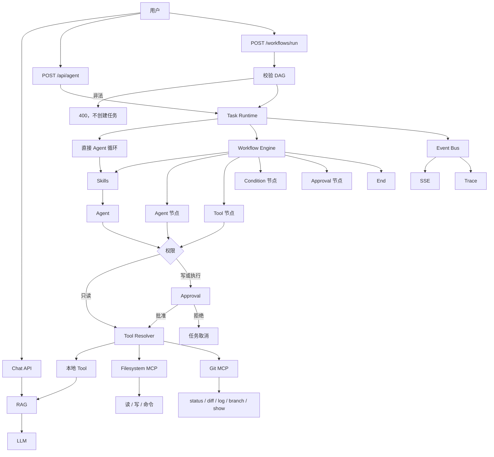

# Agent Workbench

基于 Next.js 16 构建的 AI 助手应用，集成了多轮对话、Agent 工具调用与 RAG 知识库检索能力。

## 功能特性

- **对话聊天**：支持多会话管理的流式对话（`src/app/api/chat`、`ChatSidebar`）。
- **Agent 工具调用**：基于工具注册表的 Agent 循环（`src/lib/agent`）。
- **RAG 知识库**：文档上传、分块、向量化、索引与相似度检索的完整流程（`src/lib/rag`、`src/app/knowledge`）。
- **模型接入**：对话模型与 Embedding 模型通过环境变量配置，默认对接百度千帆（Qianfan）。
- **MCP 与 Skills**：本地工具和文件系统 MCP 走同一套解析；技能从 `.agent/skills` 加载。
- **Coding Agent**：`writeFile` 和 `runCommand` 必须先经过人工审批。
- **Trace**：任务结束后仍可查看步骤、工具、审批和指标，并用 `pnpm agent:evaluate` 做回归。
- **Workflow**：提交节点和边，校验为有向无环图后在任务里执行；用 `pnpm workflow:evaluate` 做回归。
- **Git**：通过只读 MCP 查看 status、diff、log、branch 和 show。

## 架构演进

当前版本是 **v1.2.0**。下图是这一版当时的完整架构，各历史版本的图见 [docs/architecture](docs/architecture/README.md)。



| 版本 | 新增 |
| --- | --- |
| 基线 | 多会话对话、RAG 检索、本地工具（`searchKnowledge`、`getCurrentTime`） |
| Agent Loop | LLM 与工具交替执行，步数达到上限则失败 |
| Task Runtime | 一次执行变成任务：`pending → running → completed / failed`，可用 task id 查询 |
| v0.8.0 MCP + Skills | SSE 推送事件；Tool Resolver 合并本地工具与 filesystem MCP；从 `.agent/skills` 加载技能。文件访问限制在工作区根目录 |
| v0.9.0 Coding Agent | `writeFile`、白名单 `runCommand`；有副作用的工具先进入 `waiting`，批准后才继续 |
| v1.0.0 Trace | Event Bus 聚合成可回读的 Trace 和指标；脱敏后不保存文件正文和敏感命令输出；`pnpm agent:evaluate` 跑固定用例 |
| v1.1.0 Workflow | 校验通过的有向无环图可在任务内执行；节点为 Agent、Tool、Condition、Approval、End |
| v1.2.0 Git MCP | 只读查看仓库状态、差异、日志、分支和提交；不能 add、commit 或 push |

每个版本的分层和工作流见 [docs/architecture](docs/architecture/README.md)。

## 技术栈

- Next.js 16 / React 19
- TypeScript
- Ant Design 6
- Vercel AI SDK (`ai`、`@ai-sdk/openai`、`@ai-sdk/react`)
- 包管理：pnpm

## 快速开始

### 1. 安装依赖

```bash
pnpm install
```

### 2. 配置环境变量

复制示例文件并填入你自己的密钥：

```bash
cp .env.example .env.local
```

需要配置的变量见 `.env.example`：

- `AI_API_KEY` / `AI_BASE_URL` / `AI_MODEL`：对话模型配置
- `COMMON_API_KEY` / `EMBEDDING_MODEL`：向量化模型配置

> `.env.local` 已在 `.gitignore` 中忽略，请勿将真实密钥提交到仓库。

### 3. 启动开发服务器

```bash
pnpm dev
```

浏览器打开 [http://localhost:3000](http://localhost:3000) 查看效果。

## 常用脚本

```bash
pnpm dev             # 启动开发服务器
pnpm build           # 生产构建
pnpm start           # 启动生产服务
pnpm lint            # 代码检查
pnpm rag:evaluate    # RAG 检索效果评估
pnpm rag:multiturn   # RAG 多轮对话回归测试
pnpm agent:evaluate  # Agent Trace 回归评估
pnpm workflow:evaluate  # Workflow 回归评估
pnpm git:evaluate    # Git 只读工具回归评估
```

## 目录结构

```
src/
├── app/            # 页面与 API 路由（chat / agent / knowledge）
├── components/     # UI 组件
├── hooks/          # React Hooks
├── lib/
│   ├── agent/      # Loop、Task、审批、Trace
│   ├── mcp/        # filesystem MCP 与受控命令
│   ├── rag/        # RAG：分块、向量化、索引、检索
│   └── chat/       # 消息处理
└── types/          # 类型定义
data/               # 知识库与评估数据
scripts/            # RAG 评估脚本
```
