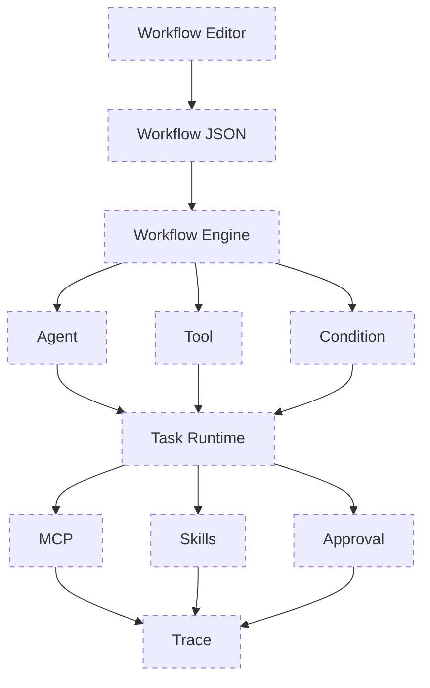

# 基线：对话与 RAG

## 总述

这一阶段还没有 Agent。用户发来消息后，服务端自己决定「先查知识库，再让模型回答」。模型只负责根据已经准备好的资料生成文本，不能选择工具，也不能改文件。

本地工具函数（知识库检索、当前时间）这时已经作为库代码存在，但调用方是服务端，不是模型。

本版一层都还没有点亮。实际在跑的是 Chat → RAG → LLM：服务端自己检索，再让模型回答。

### 相对上一版

这是起点，没有上一版。它定下了后面所有版本都还在用的两件事：

- 对话模型和向量模型分开配置（`AI_*` 与 `COMMON_API_KEY` / `EMBEDDING_MODEL`）。
- 知识库的检索结果是带文件名和分数的文本片段，不是原始向量。

### 这一版还没有

- 模型主动调用工具
- 多步循环和步数上限
- 任务状态
- MCP、技能、审批、Trace

## 工作流

1. `POST /api/chat` 收到 `messages`。为空则直接 400。
2. 从末尾找到最后一条用户消息，作为本次查询。
3. 更早的用户/助手消息只保留最近 6 条，作为改写查询用的历史。当前这条用户消息不放进历史。
4. `shouldRewriteQuery` 判断要不要改写。需要时才调用模型，把「它」「上面那个」这类指代收成一句独立问题；不需要时原句直接检索。
5. 查询向量化后做相似度检索，取得分最高的若干片段。
6. 片段被写成系统提示里的资料。模型通过 `streamText` 流式生成回答，历史消息内联回传，避免多轮对话把上一条助手消息变成无法识别的引用。
7. 响应是 UI 消息流。检索或模型失败时返回 500，没有任务 id，也没有重试循环。

## 分层

| 层 | 职责 | 位置 |
| --- | --- | --- |
| 对话入口 | 解析消息、编排检索和生成 | `src/app/api/chat/route.ts` |
| 检索 | 判断改写、向量检索、组装提示 | `src/lib/rag/rag.ts` |
| 模型 | 对话模型客户端 | `src/lib/ai.ts` |

知识库本身还有上传、分块、向量化和索引，那是资料怎么进来，不是回答时的工作流。回答时只读已经建好的索引。
