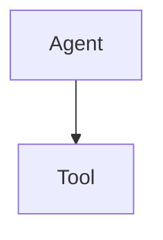

# Agent Loop：模型自己决定调用工具

## 总述

从这一阶段起才有 Agent。基线里「每次都先检索再回答」变成「模型看过问题后，自己决定要不要调用工具」。工具执行完，结果回到模型，模型可以继续调用，直到给出最终答案或达到步数上限。

`/api/chat` 的检索后回答路径保留，不改成 Agent。

本版新加的层是 Agent 和 Tool。Agent 决定要不要往下调用 Tool；Tool 只有 `searchKnowledge` 和 `getCurrentTime`。没有 Task Runtime，一次调用结束就结束。

### 从基线转变了什么

保留：

- 知识库检索实现不动。`searchKnowledge` 只是把 `retrieveKnowledge` 包成模型能调用的工具，检索时不再把聊天历史送进去做二次改写，因为模型已经给出了一句独立查询。
- 对话模型仍然是原来的 `aiModel`。

改变：

- 谁决定检索，从服务端改成模型。问题不需要资料时，可以不调用 `searchKnowledge`，直接回答。
- 一次用户问题可以包含多步。同一步里也可以有多次工具调用。AI SDK 会把助手的工具调用和工具结果追加进上下文，循环本身不再手写分支。

新增：

- 本地工具注册表：`searchKnowledge`、`getCurrentTime`。
- 步数上限 `MAX_AGENT_STEPS`。结束原因仍是「还想调用工具」时，抛出 `AgentLoopLimitError`，而不是假装已经回答完。
- 工具失败返回 `{ success: false, error }`，不把整个请求打成未捕获异常。

### 这一版还没有

- 任务 id 和状态。调用方只能等这一次 `runAgent` 结束。
- 流式事件。循环内部当时用日志观察步骤。
- MCP、技能、审批、Trace。

## 工作流

1. 调用方把 `{ role, content }` 消息交给 `runAgent`。
2. 系统提示要求模型：需要资料时调用 `searchKnowledge`，需要当前时间时调用 `getCurrentTime`，否则直接回答。
3. `generateText` 按 `stopWhen: stepCountIs(maxSteps)` 运行。
4. 每一步开始，记下步号。若这一步有工具调用，执行对应 `execute`，把名称、入参和结果收集起来。
5. 工具结果回到模型。模型可以据此再调用工具，或输出最终文本。
6. 正常结束时返回 `{ answer, toolCalls, steps }`。
7. 若步数用尽时 `finishReason` 仍是 `tool-calls`，说明模型还没给出最终答案。这时抛出 `AgentLoopLimitError`，带上已经走过的步数。

## 分层

| 层 | 职责 | 位置 |
| --- | --- | --- |
| Loop | 多步调用、收集工具记录、判定上限 | `src/lib/agent/loop.ts` |
| 工具实现 | 检索知识库、读取当前时间 | `src/lib/agent/tools.ts` |
| 注册表 | 把工具收成 Loop 使用的 ToolSet | `src/lib/agent/registry.ts` |

Loop 只认识统一的工具集合，不关心知识库内部怎么向量化。
