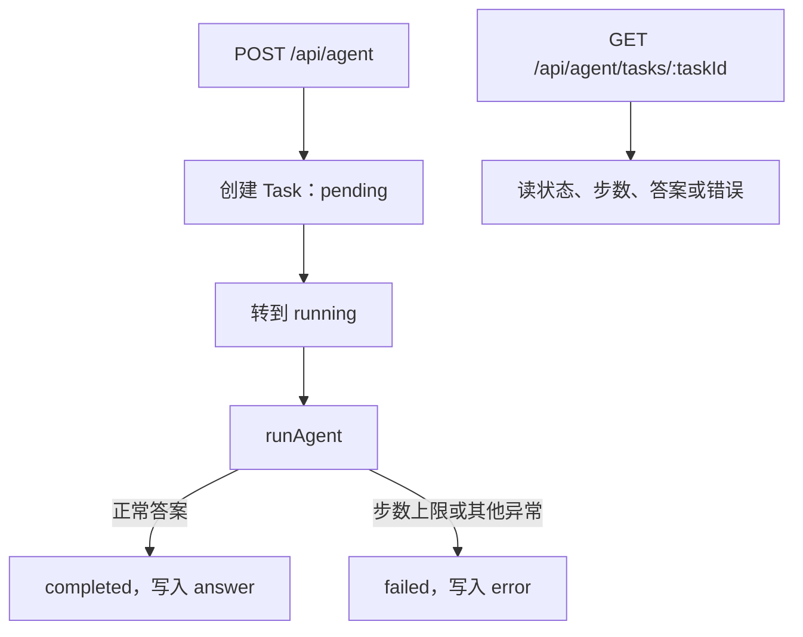
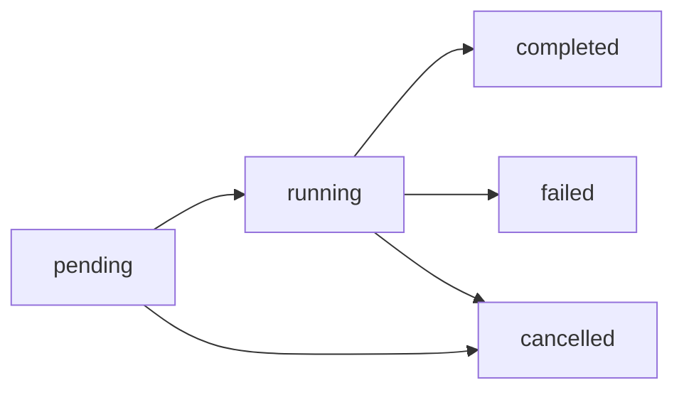

# Task Runtime：一次执行变成可查询的任务

## 总述

Agent Loop 仍然负责「模型和工具怎么交替」。这一版在它外面加了任务：每次请求先变成一条有 id、有状态的 Task，再驱动 Loop。调用方不必一直握着那次函数调用，可以用 task id 回来看状态和答案。



状态只允许这些转换：



`waiting` 在状态机里已经留了位置，这一版的执行路径还不会进入它。

### 从 Agent Loop 转变了什么

保留：

- `runAgent` 的循环、工具注册表和步数上限不变。Runtime 不自己调用模型。

改变：

- 对外结果从「函数返回值」变成「任务记录」。步数上限不再直接变成未处理异常，而是记成任务错误 `AGENT_LOOP_LIMIT`，HTTP 用 409；其他失败用 500。两种失败都带上 `taskId`。
- 成功时答案写在任务上，响应里是 `taskId`、`status`、`answer`、`steps`。

新增：

- 内存任务库和合法状态转换。非法转换会抛错，避免把已完成任务再改回运行中。
- `GET /api/agent/tasks/:taskId`。任务不存在时 404。

### 这一版还没有

- 默认仍是同步：请求会等到任务结束才返回。
- 没有事件流，外部看不到中间步骤。
- 工具仍只有本地的 `searchKnowledge` 和 `getCurrentTime`。
- 没有审批，也没有 Trace。

## 工作流

1. `POST /api/agent` 只接受非空的 user/assistant 文本消息。
2. Runtime 创建任务，状态是 `pending`，记下消息、最大步数和创建时间。
3. 状态转到 `running`，调用 `runAgent`。
4. Loop 正常返回后，把答案和步数写回任务，再转到 `completed`。
5. Loop 抛出错时，任务转到 `failed`。步数上限和其他错误用不同的 `code`，方便调用方区分。
6. 之后任何人用 task id 读取这份记录。存储挂在进程内存里，只适合单进程验证；重启后任务消失。

## 分层

```text
HTTP /api/agent
  → Task Runtime（创建、转移状态、捕获异常）
    → Agent Loop（模型与工具）
      → Local Tool Registry
```

| 层 | 职责 | 位置 |
| --- | --- | --- |
| HTTP | 校验消息，把任务结果映射成状态码 | `src/app/api/agent/route.ts` |
| Runtime | 创建任务并驱动 Loop | `src/lib/agent/task/runtime.ts` |
| 状态机 | 只允许合法转换 | `src/lib/agent/task/state-machine.ts` |
| 存储 | 按 id 保存任务 | `src/lib/agent/task/store.ts` |
