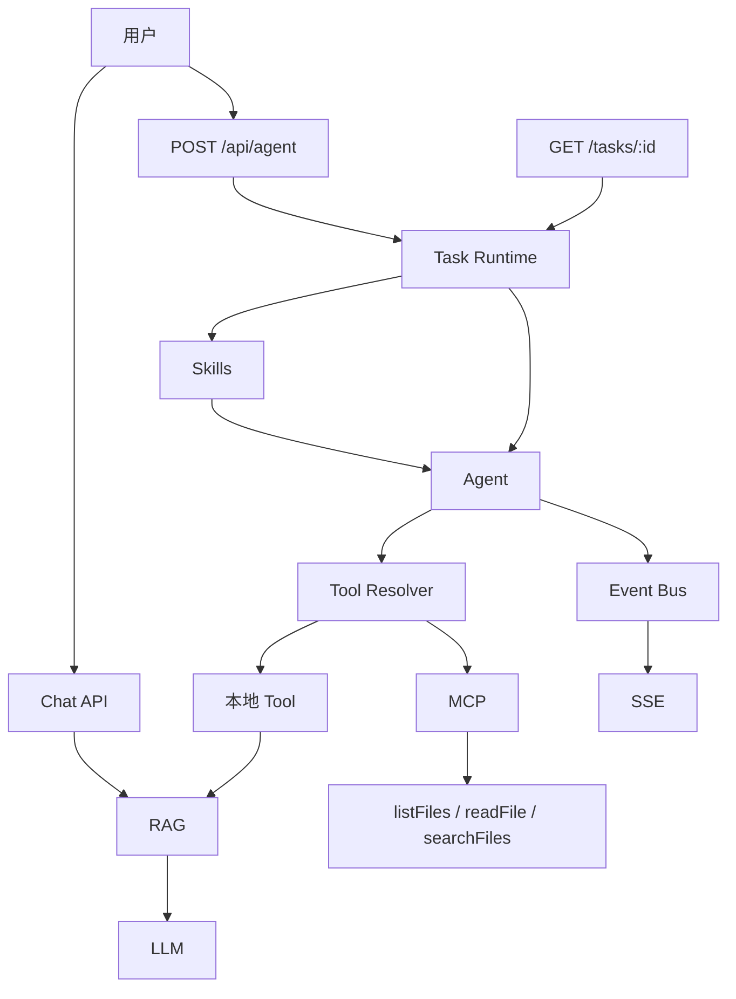

# v0.8.0：MCP + Skills

## 总述

任务和 Agent Loop 还在，但执行过程变成可以订阅的事件流。工具不再只有进程内的两个函数：文件系统能力放在独立的 MCP 进程里，和本地工具合成同一套 ToolSet。技能是写在 Markdown 里的任务指南，启动时注入系统提示，告诉模型「这类题应该怎么做」，而不是新增一个工具。



本版的完整链路是：任务在后台跑，Skills 进入系统提示，本地工具和 MCP 合成一套再交给 Agent，步骤经 Event Bus 推到 SSE。默认请求立即返回 task id。对话路径仍在。还不能写文件，也没有审批和 Trace。

### 从 Task Runtime 转变了什么

保留：

- 任务状态机、task id、同步等待模式。请求体带 `{ "wait": true }` 时，仍然等到结束再返回答案，和上一版的调用方式兼容。
- 本地工具 `searchKnowledge`、`getCurrentTime` 仍在。

改变：

- 默认不再同步阻塞。`POST /api/agent` 创建任务后返回 202 和 `{ taskId, status }`，Agent 在后台跑。
- Loop 从只在结束时给结果，变成边跑边发事件。Runtime 改用 `streamAgent`。事件包括步骤开始、请求模型、工具开始和结束、文本增量、步骤结束。
- Loop 不再写死本地注册表。它拿到的是 Resolver 合并后的工具集，因此不知道某个工具来自本地还是 MCP。

新增：

- 内存 Event Bus，按 task id 隔离订阅者。`GET /api/agent/tasks/:taskId/stream` 用 SSE 把事件推给页面。
- MCP Client 用 stdio 拉起 `filesystem-mcp`。服务不可用时退回只有本地工具，`/api/agent` 仍然能工作。
- 文件系统工具 `listFiles`、`readFile`、`searchFiles`。路径必须落在工作区根目录内，拒绝 `../`、绝对路径和符号链接逃逸。
- Skill Discovery 与 Loading。每个技能是 `.agent/skills/<name>/SKILL.md`。本版带来 `knowledge-research`：先判断要不要检索，再调用 `searchKnowledge`，资料不够就说明没找到，不要编造。

### 这一版还没有

- 写文件和执行命令。MCP 只有读和搜索。
- 人工审批。工具一旦被模型选中就会执行。
- 任务结束后的 Trace。SSE 是实时流，连接结束后看不到聚合记录。

## 工作流

1. 客户端 `POST /api/agent`。不传 `wait` 时立刻拿到 task id。
2. Runtime 创建任务并发出 `task.created`，状态转到 `running`，发出 `task.started`。
3. 并行做两件事：Resolver 连接 MCP 并合并工具；`loadSkillInstructions` 读取全部技能 Markdown。技能为空或 MCP 失败都不中断任务。
4. `streamAgent` 用合并后的工具和技能文本运行。技能拼在系统提示里，工具仍由模型决定是否调用。
5. 流里的每一步都变成任务事件，发布到 Event Bus。已连接的 SSE 客户端按 `id` / `event` / `data` 收到它们。
6. 模型给出最终文本后，任务写入答案并转到 `completed`。步数用尽或执行异常则转到 `failed`。
7. 页面 `/agent` 用这条路径验证：提交问题、订阅 SSE、把事件打在屏幕上。

读文件时的安全检查发生在 MCP 进程内：先把用户给的相对路径解析到真实路径，确认仍在工作区根下，再读取。超大文件会截断。

## 分层

```text
HTTP
  → Task Runtime
    → Event Bus → SSE
    → streamAgent
      → Tool Resolver
        → Local Tools
        → MCP Client → filesystem MCP Server
    → Skills（只进入系统提示）
```

| 层 | 职责 | 位置 |
| --- | --- | --- |
| 事件 | 按任务发布和订阅 | `src/lib/agent/task/event-bus.ts` |
| SSE | 把事件写成流 | `src/app/api/agent/tasks/[taskId]/stream/route.ts` |
| Resolver | 合并两套工具，MCP 失败则降级 | `src/lib/agent/tool-resolver.ts` |
| MCP | 子进程和协议客户端 | `src/lib/mcp/client.ts` |
| 文件工具 | 列表、读取、搜索，以及路径沙箱 | `src/lib/mcp/filesystem/` |
| 技能 | 发现并拼进系统提示 | `src/lib/agent/skills.ts` |
