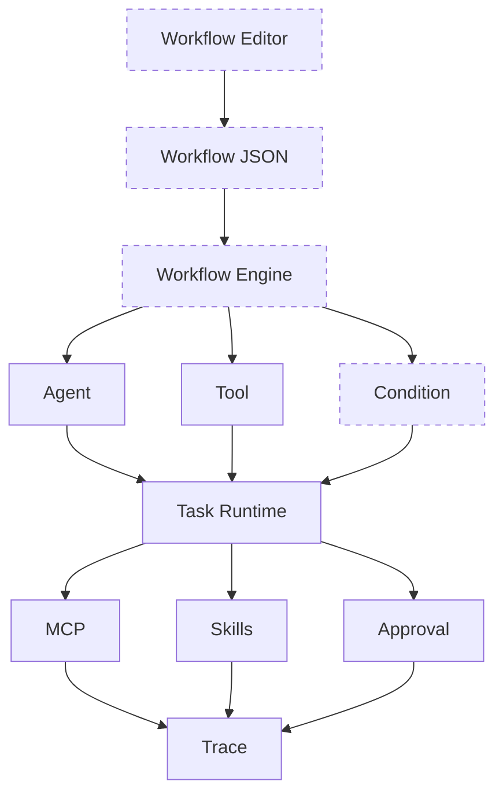

# v1.0.0：Trace、指标与评估

## 总述

v0.9.0 的事件是实时的：SSE 连着就能看见，任务结束后没有一份可回读的执行档案。这一版不改 Agent 怎么决定工具，也不改审批规则。它在 Event Bus 旁边加了一个订阅者，把同一次任务的事件收成 Trace。指标从 Trace 计算，不另记一套数。评估脚本用固定题目跑任务，再按 Trace 和文件系统判断是否通过。



本版新加的层是最底下的 Trace。上面已经实现的层行为不变。虚线的 Workflow Editor、Workflow JSON、Workflow Engine、Condition 仍未实现；Task Runtime 发出的事件在原有实时流之外，再收成一份可回读的 Trace。

### 从 v0.9.0 转变了什么

保留：

- 任务状态、SSE、MCP、技能、权限门和两条工具路径全部保留。评估只是这些路径的调用方。

改变：

- 工具事件在进入 Event Bus 之前先脱敏。`writeFile` 只留路径和字节数，不留正文；命令输出截断，并遮住看起来像密钥的字段。Trace 和 SSE 因此都不会保存整份文件内容。
- 创建任务后、发出 `task.created` 之前就 `startTrace`。Collector 必须先订阅，否则会漏掉开头的事件。

新增：

- Trace：一次任务一条记录，里面按发生顺序排列 agent、llm、tool、approval、error 步骤，每步有开始、结束、耗时和状态。
- 内存 Trace Store。任务完成或失败后记录还在，供事后查看。它仍是单进程内存，不是数据库。
- `GET /api/agent/tasks/:taskId/trace` 返回步骤；`.../trace/summary` 返回由步骤算出的指标，包括任务耗时、步数、工具次数、失败次数、审批等待时间和模型耗时。模型 token 只在供应商真正返回时才写上。
- `data/agent-evaluation.json` 和 `pnpm agent:evaluate`。用例声明期望工具和成功条件，例如最终状态是 completed、答案包含某个路径、或某个文件已经存在。

### 这一版还没有

- 跨进程的 Trace 存储。重启后档案消失。
- 对 SSE 协议本身的改写。实时流和事后 Trace 是同一批事件的两种读法。

## 工作流

执行中的 Agent 和 v0.9.0 相同。Trace 是旁路：

1. `createAndStartTask` 或 `createAndRunTask` 创建任务后立刻 `startTrace(taskId)`。
2. Collector 建立一条状态为 `running` 的 Trace，并只订阅这个 task id。
3. 事件成对闭合步骤。例如 `tool.started` 打开一个 tool 步骤，`tool.completed` 写下成功或失败、脱敏后的输出和耗时。`approval.required` 打开审批步骤，批准或拒绝时记下等待时间。
4. `task.completed`、`task.failed` 或 `task.cancelled` 把整条 Trace 收成对应终态，然后取消订阅。
5. 调用方之后用 task id 读取 Trace 或 Summary。任务已经不在运行中也读得到，只要进程还在。
6. 评估脚本按用例创建任务并等待结束，再读 Trace：检查状态、是否用过期望工具、答案是否包含指定文本，以及工作区里是否出现期望文件。

指标不在工具代码里单独累加。`computeMetrics` 只扫描 Trace 的步骤，因此 Summary 和完整 Trace 不会各说各的。

## 分层

```text
Task Runtime
  → Event Bus
      → SSE
      → Trace Collector → Trace Store → Trace API / Metrics / Evaluation
```

| 层 | 职责 | 位置 |
| --- | --- | --- |
| 采集 | 订阅事件，开合步骤 | `src/lib/agent/trace/collector.ts` |
| 脱敏 | 去掉正文和敏感输出 | `src/lib/agent/trace/sanitize.ts` |
| 存储 | 按 task id 保留 Trace | `src/lib/agent/trace/store.ts` |
| 指标 | 从步骤派生耗时和次数 | `src/lib/agent/trace/metrics.ts` |
| 评估 | 固定用例回归 | `scripts/agent-evaluate.ts` |
