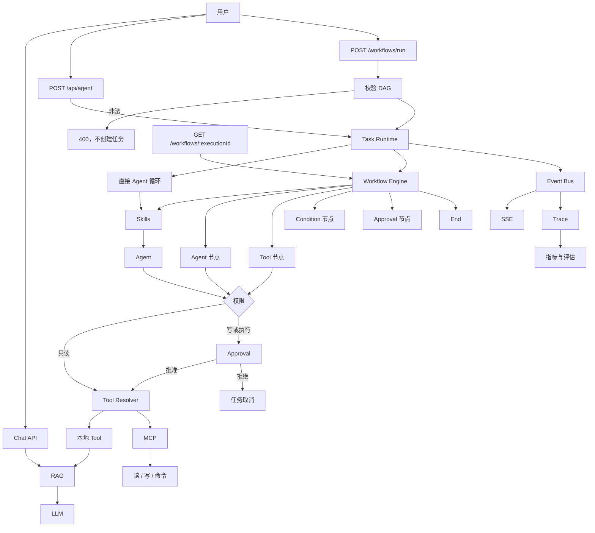

# v1.1.0：Workflow / DAG Runtime

## 总述

v1.0.0 里一次任务就是一轮 Agent 循环。这一版在任务里面增加工作流：调用方提交节点和边，校验通过后由引擎按图往下走。节点可以是 Agent、Tool、Condition、Approval 或 End。引擎只负责编排和上下文，真正调用模型、工具和审批仍走原来的 Task Runtime。



对话、直接跑 Agent、审批、MCP 和 Trace 都还在。新的入口是工作流：先校验图，再在同一个任务里按节点执行。

### 从 v1.0.0 转变了什么

保留：

- `POST /api/agent` 仍是直接的 Agent 循环，不经过引擎。
- 写文件和执行命令仍走权限门和命令白名单。工作流不能绕过。
- 事件仍进 Event Bus，同时给 SSE 和 Trace。

改变：

- 一个任务除了直接跑循环，还可以跑一份工作流定义。工作流结束时，任务状态跟着变成 completed、failed 或 cancelled。
- Trace 的步骤可以带上 `workflowId`、`executionId`、`nodeId`，能看出这一步属于哪个节点。

新增：

- 工作流定义：节点、边、版本。
- 执行前校验：必须是有向无环图，节点 id 唯一，边指向存在的节点，有且只有一个起点，其余节点可达，并有 `maxSteps`。
- 五种节点。Condition 只做字段比较（等于、不等于、是否存在），不执行任意代码。
- `POST /api/agent/workflows/run` 返回 `executionId` 和 `taskId`。`GET /api/agent/workflows/:executionId` 查询这次执行。
- `pnpm workflow:evaluate`，用 `data/workflow-evaluation.json` 里的用例做回归。

### 这一版还没有

- 可视化编辑器，也没有把工作流存成仓库里的固定 JSON 文件。定义由请求体传入。
- 工作流引擎不替代任务状态机。暂停、取消和审批等待仍由 Task Runtime 管。

## 工作流

1. 客户端提交 `{ workflow, input }`。
2. Validator 检查图。有环、缺节点、不可达或没有唯一起点时直接 400，不创建任务。
3. 校验通过后创建 Task 和 Workflow Execution，请求返回 202。
4. Runtime 解析工具、加载 Skills，并用权限门包住工具，然后把执行器交给引擎。
5. 引擎从起点沿边前进。Agent 节点调用 `streamAgent`；Tool 节点调用已经包过权限的工具；Condition 节点按上下文里的字段选择 true 或 false 出边；Approval 节点让任务进入 `waiting`，等人批准或拒绝；End 节点结束。
6. 每进入或离开一个节点，都发出 `workflow.node.started` / `completed` / `failed`。Trace 用这些事件记下节点归属。
7. 引擎结束后，若任务仍在运行，Runtime 按工作流终态收尾。之后可以用 execution id 读到状态和上下文。

## 分层

```text
POST /workflows/run
  → Validator
  → Task Runtime
      → Workflow Engine（编排节点和 context）
          → Agent / Tool / Condition / Approval / End
      → 原有权限门、MCP、Skills、Event Bus、Trace
```

| 层 | 职责 | 位置 |
| --- | --- | --- |
| 定义 | 节点、边、条件运算符 | `src/lib/agent/workflow/types.ts` |
| 校验 | 拒绝环、重复 id、不可达节点 | `src/lib/agent/workflow/validator.ts` |
| 引擎 | 按图前进，不直接调用模型 | `src/lib/agent/workflow/engine.ts` |
| 接入 | 用现有 Agent、工具和审批执行节点 | `src/lib/agent/workflow/run.ts` |
| HTTP | 运行和查询 | `src/app/api/agent/workflows/` |
