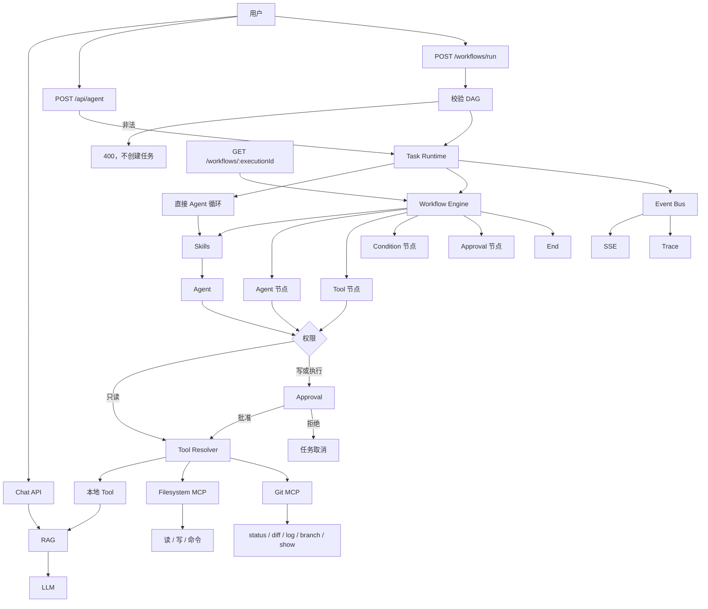

# v1.2.0：Git 只读 MCP

## 总述

v1.1.0 的 MCP 只有文件系统。这一版再挂上一个只读的 Git MCP：Agent 可以查看仓库状态、差异、日志、分支和某次提交，但不能通过它执行 `add`、`commit`、`push`。这些读取不需要审批。写文件和跑命令的权限门保持原样。



对话、工作流、审批和 Trace 都还在。工具解析从「本地 + 文件系统 MCP」变成「本地 + 文件系统 MCP + Git MCP」。Git 工具走只读分支，不进 Approval。

### 从 v1.1.0 转变了什么

保留：

- 工作流校验、节点类型、权限门、文件系统 MCP 和 Trace。
- 写文件、执行命令仍然必须审批。Git 不能用来代替这两步。

改变：

- MCP Client 从单个 filesystem 进程变成按名字登记的多个 Server。某一个连不上时跳过它，其他 Server 继续可用。
- Tool Resolver 合并三套工具。Agent 仍然只看见统一的工具名。

新增：

- `git-mcp`：`gitStatus`、`gitDiff`、`gitLog`、`gitBranch`、`gitShow`。
- 仓库必须在工作区里面。引用参数会挡住选项注入；输出有大小和行数上限。
- `pnpm git:evaluate`，用例在 `data/git-evaluation.json`。

### 这一版还没有

- `gitAdd`、`gitCommit`、`gitPush` 等写操作。权限表里只留了注释，没有实现。
- 通用的 `runGitCommand`。不能把任意 git 参数交给 shell。

## 工作流

1. 任务开始时，Resolver 分别连接 filesystem-mcp 和 git-mcp，再和本地工具合并。
2. 模型或工作流的 Tool 节点若调用 `gitStatus` 等只读工具，权限是 `allow`，直接在 git-mcp 里用 `execFile` 执行固定子命令。
3. git-mcp 先确认目标仓库位于工作区根目录之内，再跑对应的只读命令，并截断过长的 diff、log 和 show。
4. 结果回到 Agent。Trace 里对敏感字段做脱敏，和文件工具一样。
5. 若模型改而调用 `writeFile` 或 `runCommand`，仍先进入 Approval。拒绝则取消任务。

## 分层

```text
Tool Resolver
  → 本地 Tool
  → filesystem-mcp
  → git-mcp（只读，stdio）
```

| 层 | 职责 | 位置 |
| --- | --- | --- |
| 客户端 | 按 Server 名维持子进程，合并工具 | `src/lib/mcp/client.ts` |
| Git 工具 | 状态、差异、日志、分支、展示 | `src/lib/mcp/git/` |
| 权限 | 五个 git 工具为 allow | `src/lib/agent/permission.ts` |
