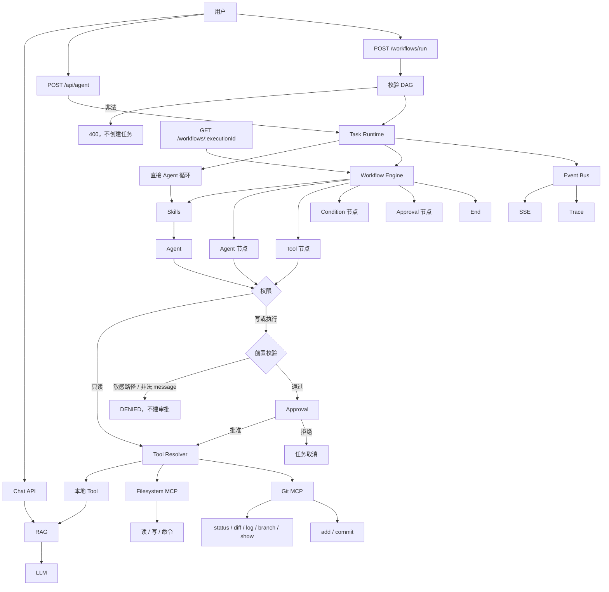

# v1.3.0：Git 写入 MCP

## 总述

v1.2.0 的 Git MCP 只能读。这一版加上 `gitAdd` 和 `gitCommit`：可以暂存明确列出的文件，并提交已经暂存的改动。这两步都要先过前置校验，再等人批准。只读 Git 工具仍然不需要审批。不能 push、pull、reset 或 checkout，也不能用一条任意 git 命令代替。



对话、工作流、审批和 Trace 都还在。Git MCP 从只读变成「只读直接执行，写入先校验再审批」。批准不能绕过校验：敏感文件、路径穿越和非法提交说明在创建审批之前就被拒绝。

### 从 v1.2.0 转变了什么

保留：

- 五个只读 Git 工具仍是 `allow`，不进 Approval。
- `writeFile`、`runCommand` 的权限门和命令白名单不变。
- 多 MCP Server、工作流校验和 Trace 都还在。

改变：

- 有副作用的工具在进入 Approval 之前先跑 Pre-approval Guard。`gitAdd` / `gitCommit` 校验失败时直接返回 `DENIED`，不创建审批。
- 工作流里工具审批被拒时，执行状态保持 `cancelled`，引擎不再把它改写成 `failed`。

新增：

- `gitAdd`：`git add -- <paths>`。路径必须明确列出；拒绝 `.`、`*`、`-A`、以 `-` 开头的参数、工作区外路径和敏感文件。
- `gitCommit`：`git commit -m <message>`。不会自动 add。message 必须是单行、非空、不超过 200 字符。
- Coding skill 要求暂存和提交只用这两个工具，不要用 `runCommand` 去跑 `git add` / `git commit`。
- `pnpm git:write:evaluate`，用例在 `data/git-write-evaluation.json`。

### 这一版还没有

- `gitPush`、`pull`、`reset`、`checkout`。
- 通用的 `runGitCommand`。不能把任意 git 参数交给 shell。
- `gitCommit` 不会把未暂存的文件一并加进去。
- 不能用 `.` 或 `-A` 一次暂存整个工作区。

## 工作流

1. 任务开始时，Resolver 仍连接 filesystem-mcp 和 git-mcp。git-mcp 同时登记只读工具和 `gitAdd`、`gitCommit`。
2. 模型或工作流的 Tool 节点若调用 `gitStatus` 等只读工具，权限是 `allow`，直接在 git-mcp 里用 `execFile` 执行固定子命令。
3. 若调用 `gitAdd` 或 `gitCommit`，先做前置校验。路径不在工作区、是敏感文件、属于批量暂存，或 message 为空、含换行、超长，立即 `DENIED`。任务不进入 `waiting`，也不会出现一条可批准的审批。
4. 校验通过后才创建 Approval，任务进入 `waiting`。拒绝则任务取消；若这是工作流里的工具节点，执行状态保持 `cancelled`。
5. 批准后 git-mcp 用 `execFile`（`shell: false`）执行固定参数：add 只接受校验过的相对路径，commit 只接受 `-m` 和这一条 message。
6. 结果回到 Agent。Trace 对 `gitAdd` 只记路径，对 `gitCommit` 只记 message。

## 分层

```text
Tool Resolver
  → 本地 Tool
  → filesystem-mcp
  → git-mcp（stdio）
      只读：status / diff / log / branch / show（allow）
      写入：add / commit（先 Guard，再 Approval）
```

| 层 | 职责 | 位置 |
| --- | --- | --- |
| 前置校验 | 审批前拒绝敏感路径、穿越、批量暂存和非法 message | `src/lib/agent/guard.ts` |
| Git 写入 | `gitAdd`、`gitCommit`，固定参数，不经 shell | `src/lib/mcp/git/` |
| 权限 | 五个只读 git 工具为 allow；`gitAdd` / `gitCommit` 需要审批 | `src/lib/agent/permission.ts` |
| 工作流终态 | 工具审批被拒时保持 cancelled | `src/lib/agent/workflow/` |
