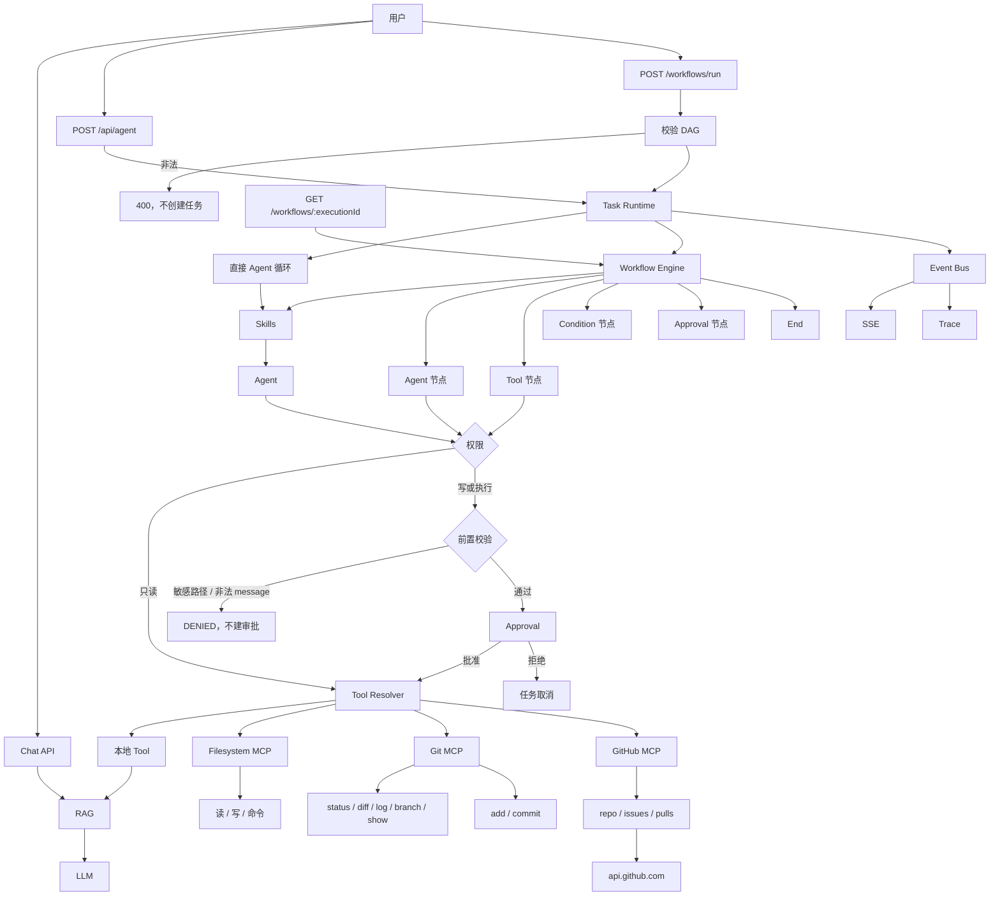

# v1.4.0：GitHub 只读 MCP

## 总述

v1.3.0 能看的只有本机仓库。这一版再挂一个只读的 GitHub MCP：Agent 可以查看环境变量里配置的那一个仓库、它的 Issue 和 Pull Request。这些读取不需要审批。不能创建或修改 Issue，不能创建、合并、评论或审查 PR，也不能 push。



对话、工作流、本地 Git、审批和 Trace 都还在。工具解析从「本地 + 文件系统 MCP + Git MCP」变成再加 GitHub MCP。GitHub 工具走只读分支，不进 Approval。仓库由 `GITHUB_OWNER` / `GITHUB_REPO` 固定，调用方不能改成别的地址。

### 从 v1.3.0 转变了什么

保留：

- 本地 Git 的五个只读工具，以及 `gitAdd` / `gitCommit` 的前置校验和审批。
- `writeFile`、`runCommand` 的权限门。
- 某个 MCP Server 连不上时跳过它，其他 Server 继续可用。

改变：

- MCP Client 登记的 Server 增加 `github`。Agent 仍然只看见统一的工具名。
- Coding skill 写明 GitHub 只能读：不得创建或修改 Issue，不得创建、合并、评论或审查 PR，不得 push。

新增：

- `github-mcp`：`githubRepo`、`githubIssues`、`githubIssue`、`githubPullRequests`、`githubPullRequest`。
- 只访问 `https://api.github.com`。路径由 owner、repo 和编号拼接，不接受调用方传入的 URL，也没有通用的 `fetchUrl`。
- `GITHUB_TOKEN` 只放在 `Authorization` 请求头里。工具返回值、错误、Trace、事件和日志都不包含它。缺少 token 或仓库配置时返回 `success: false`，不让 `/api/agent` 崩溃。
- Issue 列表会滤掉 Pull Request。列表默认 20 条、最多 50 条。Issue 和 PR 正文超过 20000 字符会截断。
- `pnpm github:evaluate`，用例在 `data/github-evaluation.json`。

### 这一版还没有

- 创建、修改、评论 Issue，或创建、合并、评论、审查 Pull Request。
- 查询环境变量以外的仓库。owner 和 repo 不能由工具参数指定。
- `gitPush`，以及任意 HTTP 请求。

## 工作流

1. 任务开始时，Resolver 分别连接 filesystem-mcp、git-mcp 和 github-mcp，再和本地工具合并。github-mcp 连不上时，另外两个 Server 照常可用。
2. 模型或工作流的 Tool 节点若调用 `githubRepo` 等工具，权限是 `allow`，直接进入 github-mcp。
3. github-mcp 读取 `GITHUB_TOKEN`、`GITHUB_OWNER`、`GITHUB_REPO`。缺任一项就返回失败，不发请求。
4. 请求只打到 `api.github.com` 上由这三项拼出的路径。列表数量会被夹到 1–50。Issue 列表去掉带 `pull_request` 字段的条目。正文超长则截断。
5. 结果回到 Agent。Token 不出现在返回值里；GitHub 返回非 2xx 时只保留状态码，不把响应体交给模型。
6. 若模型改而调用 `gitAdd`、`gitCommit`、`writeFile` 或 `runCommand`，仍走原来的前置校验和 Approval。GitHub MCP 没有写工具可以绕过这一步。

## 分层

```text
Tool Resolver
  → 本地 Tool
  → filesystem-mcp
  → git-mcp（只读 allow；add / commit 先 Guard 再 Approval）
  → github-mcp（只读，stdio，远程 api.github.com）
```

| 层 | 职责 | 位置 |
| --- | --- | --- |
| 客户端 | 按 Server 名维持子进程，合并工具 | `src/lib/mcp/client.ts` |
| GitHub 工具 | 仓库、Issue、Pull Request，只读 | `src/lib/mcp/github/` |
| 权限 | 五个 GitHub 工具为 allow | `src/lib/agent/permission.ts` |
