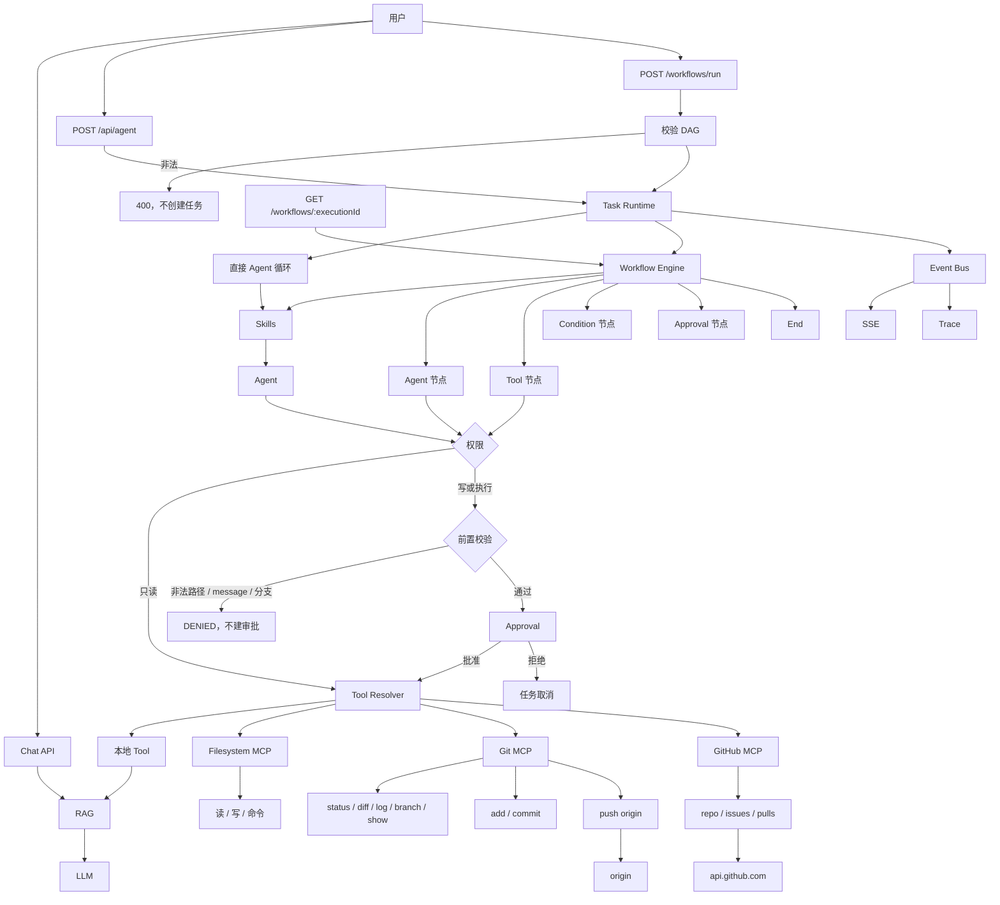

# v1.5.0：Git Push

## 总述

v1.4.0 能改的 Git 只停在本机：暂存和提交都不会离开这台机器。这一版加上 `gitPush`，可以把本地分支推到 `origin`。推送是外部副作用，必须先校验 remote 和分支，再等人批准。不能 force push，不能删分支，不能自动设置 upstream，也不能推到 `origin` 以外的远程。GitHub MCP 仍然只读。



对话、工作流、GitHub 只读、审批和 Trace 都还在。`gitPush` 走写入分支：校验失败直接 `DENIED`，通过后才创建审批。批准不能把参数改成 `--force` 或其他远程。

### 从 v1.4.0 转变了什么

保留：

- 五个只读 Git 工具仍是 `allow`。`gitAdd` / `gitCommit` 仍先校验再审批，提交不会自动暂存。
- GitHub 的五个工具仍只读，不能创建、修改、合并或评论。
- `writeFile`、`runCommand` 的权限门不变。不能用 `runCommand` 去执行 `git push`。

改变：

- 前置校验除了敏感路径和非法 commit message，也拒绝非法的 push remote 和分支。这些情况不创建审批。
- Coding skill 要求推送前先看 `gitStatus` / `gitDiff` 和当前分支。有未提交修改时先提示用户走 `gitCommit`，不要绕过那次审批。

新增：

- `gitPush`：固定为 `git push origin <branch>`。remote 省略时就是 `origin`，写成别的名字会被拒绝。branch 省略时用当前分支，且必须已经存在于本地。
- 分支名不能以 `-` 开头，不能包含空白、控制字符或 shell 元字符，长度不超过 200。因此 `--force`、`--delete`、`-u` 都进不了参数列表。
- 执行用 `execFile`，`shell: false`，参数只有 `push`、`origin` 和校验过的分支。输出截断到 5000 字符。
- Trace 对 `gitPush` 只记 remote 和 branch。
- `pnpm git:push:evaluate`，用例在 `data/git-push-evaluation.json`。评估可设 `AGENT_GIT_PUSH_MODE=mock`，校验和审批仍真实执行，但不发起网络推送。

### 这一版还没有

- force push、删除远程分支、`git push -u`。
- 推送到 `origin` 以外的远程。
- `pull`、`reset`、`checkout`。
- 用 GitHub MCP 创建或合并 Pull Request。

## 工作流

1. 模型或工作流的 Tool 节点调用 `gitPush`。权限是 `approval_required`，先进入前置校验。
2. remote 不是 `origin`、分支不存在、以 `-` 开头或含有非法字符时，直接 `DENIED`。任务不进入 `waiting`。
3. 校验通过后创建 Approval，任务进入 `waiting`。拒绝则任务取消；工作流里的工具节点保持 `cancelled`。
4. 批准后 git-mcp 在工作区内执行 `git push origin <branch>`，不附加任何其他参数。
5. 成功或失败的输出都会截断。Trace 只保留 remote 和 branch，不保留可能含凭据的长输出。
6. 只读 Git 和 GitHub 工具仍不进审批。`gitAdd`、`gitCommit`、`writeFile`、`runCommand` 仍走各自原来的校验和审批。

## 分层

```text
Tool Resolver
  → 本地 Tool
  → filesystem-mcp
  → git-mcp
      只读：status / diff / log / branch / show（allow）
      写入：add / commit / push origin（先 Guard，再 Approval）
  → github-mcp（只读，不推送）
```

| 层 | 职责 | 位置 |
| --- | --- | --- |
| 前置校验 | 审批前拒绝非法 remote、不存在的分支和选项注入 | `src/lib/agent/guard.ts` |
| Git 推送 | 只执行 `git push origin <branch>` | `src/lib/mcp/git/` |
| 权限 | `gitPush` 需要审批 | `src/lib/agent/permission.ts` |
