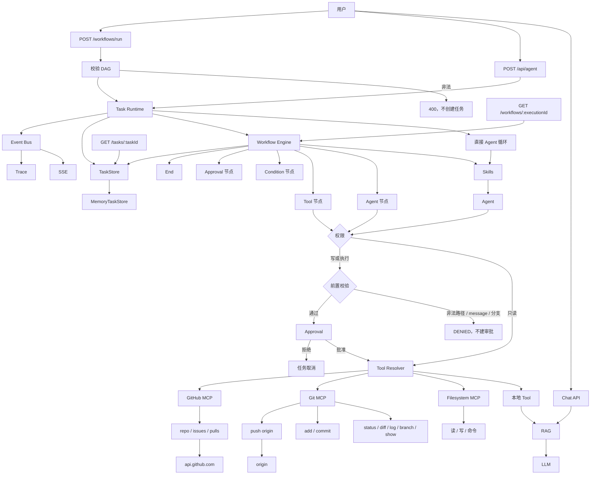

# v1.6.0：Task Persistence

## 总述

v1.5.0 的任务直接写在 Runtime 手里的内存 Map 上。这一版把创建、读取、更新、状态流转和事件日志收成 `TaskStore` 接口。Runtime、工作流和任务 API 只调用这个异步接口，不再自己碰 `Map`。眼下唯一的实现仍是进程内的 `MemoryTaskStore`，重启后任务还是会丢。接口先做成 async，是为了以后换成 Redis 或数据库时不用再改 Runtime。



对话、Git、GitHub、审批和 Trace 都还在。变的是任务落在哪里：状态和事件先经过 `TaskStore`，再由内存实现保存。查询任务的 API 也从这里读，不再引用旧的模块级函数。

### 从 v1.5.0 转变了什么

保留：

- 任务状态机没变：`pending → running → waiting → completed / failed / cancelled`。非法转换仍然抛错。
- Event Bus、SSE 和 Trace 仍是另一条路径。Trace 自己的存储没有并进 `TaskStore`。
- Git、GitHub、权限门和工作流节点类型都不变。

改变：

- `createAndStartTask` 和 `createAndStartWorkflowTask` 改成 async，要等 Store 把任务写完再返回。
- 状态变更只走 `transition`。已经处于目标状态时直接返回，重复取消不再报错。
- 任务查询、SSE、审批和 Trace 接口在读任务时都经过 Store。Trace 正文仍从原来的 Trace Store 取。

新增：

- `TaskStore`：`create`、`get`、`update`、`transition`、`delete`、`list`，以及事件的 `appendEvent` / `getEvents`。`update` 不能改 `status`。
- `MemoryTaskStore`：`Map` 挂在 `globalThis` 上，避开开发时热重载把任务清空。方法是 async，但数据仍在当前进程里。
- `pnpm task:persistence:evaluate`，用例在 `data/task-persistence-evaluation.json`。覆盖创建、更新、生命周期、失败、取消、删除、列表，以及和 Runtime、审批的衔接。

### 这一版还没有

- Redis、PostgreSQL 或 SQLite。进程退出后任务和事件都没有了。
- 崩溃后续跑，或多实例共享同一份任务。
- 把 Trace、审批记录和工作流执行也放进同一个 Store。

## 工作流

1. `POST /api/agent` 或工作流入口调用 `create`。任务以 `pending` 写入 Store，同时发出 `task.created`。
2. Runtime 用 `transition` 把任务改成 `running`。之后每一步的状态、回答和错误都通过 `update` 或 `transition` 写回。
3. 需要审批时先 `transition` 到 `waiting`。批准后回到 `running`；拒绝则到 `cancelled`。若任务已经是 `cancelled`，再次取消是空操作。
4. 同一条事件既发给 Event Bus（给 SSE 和 Trace），也 `appendEvent` 进 Store。
5. `GET /api/agent/tasks/:taskId` 以及审批、流和 Trace 路由都用 `get` 确认任务还在。Trace 的步骤明细仍读 Trace Store。
6. 当前 `getTaskStore()` 固定返回 `MemoryTaskStore`。换成别的实现时，Runtime 和这些路由不用改调用方式。

## 分层

```text
Task Runtime / Workflow Engine / Task API
  → TaskStore
      → MemoryTaskStore（本进程 Map）
```

| 层 | 职责 | 位置 |
| --- | --- | --- |
| 接口 | 任务与事件的异步读写，状态变更走状态机 | `src/lib/agent/task/task-store.ts` |
| 内存实现 | 单进程 Map，热重载时挂在 `globalThis` | `src/lib/agent/task/task-store.ts` |
| 调用方 | 创建任务、流转状态、查询任务 | `src/lib/agent/task/runtime.ts`、`src/lib/agent/workflow/run.ts`、`src/app/api/agent/` |
