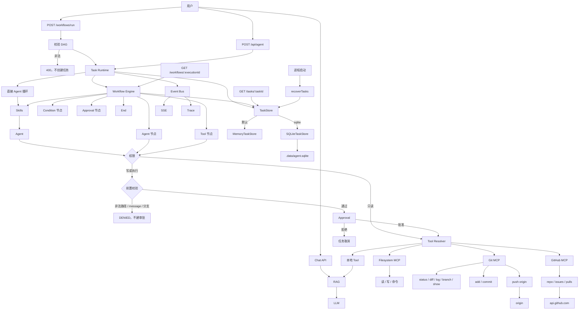

# v1.7.0：SQLite Task Persistence

## 总述

v1.6.0 的 `TaskStore` 只有内存实现，进程一停任务就没了。这一版加上 `SQLiteTaskStore`：设置 `AGENT_TASK_STORE=sqlite` 后，任务和事件写进本地 SQLite 文件，重启后还在。启动时会把上次没跑完的 `running` / `waiting` 收成 `failed`，不重新执行，也不自动批准。不设这个环境变量时，仍然用 `MemoryTaskStore`。



对话、Git、GitHub、审批和 Trace 都还在。Runtime 仍然只认识 `getTaskStore()`，不自己判断该用内存还是 SQLite。选哪种实现只发生在这一处。

### 从 v1.6.0 转变了什么

保留：

- `TaskStore` 的异步接口和状态机没变。`update` 仍然不能改 `status`。同态 `transition` 仍然是空操作。
- 默认存储仍是 `MemoryTaskStore`。不设 `AGENT_TASK_STORE=sqlite` 时，行为和上一版一样，重启后任务消失。
- Trace 和内存里的 Approval 对象没有搬进数据库。Event Bus 仍负责当前进程里的实时推送。

改变：

- `getTaskStore()` 按环境变量返回内存或 SQLite 实现。数据库路径默认是 `.data/agent.sqlite`，可用 `AGENT_TASK_DB_PATH` 改。
- SSE 重放本来就读 Store 里的事件。换成 SQLite 之后，这些事件按 `sequence` 排序，进程重启后仍能回放。

新增：

- `SQLiteTaskStore`，用 Node 自带的 `node:sqlite`，没有新依赖。表是 `agent_tasks` 和 `agent_task_events`。事件主键是 `(task_id, sequence)`，同一任务内序号严格递增。`transition` 和追加事件都在事务里完成，非法状态转换会回滚。
- 进程启动时 Next.js instrumentation 调用 `initializeAgentRuntime()`。它只处理 `running` 和 `waiting`：写成 `failed`，记一条 `task.recovered`。`running` 的原因是进程中断；`waiting` 的原因是审批状态已经丢失。已经结束的任务会跳过，重复启动不会再改它们。
- `pnpm task:sqlite:evaluate`，用例在 `data/task-sqlite-evaluation.json`。其中包含跨进程仍能读到任务，以及恢复 `running` / `waiting` 的检查。

### 这一版还没有

- 重启后接着跑未完成的模型或工具调用。恢复只做安全收尾。
- 重启后自动批准还在等待的审批。
- 把 Trace 和 Approval 对象本身持久化。
- 多实例共享同一份任务。SQLite 文件是本机单进程用的。

## 工作流

1. 进程启动时，`src/instrumentation.ts` 在 Node.js runtime 里调用一次 `recoverTasks`。热重载或重复调用不会再跑。恢复失败只打日志，不让应用起不来。
2. 恢复扫描全部任务。`pending`、`completed`、`failed`、`cancelled` 保持原样。`running` 和 `waiting` 先写入 `RECOVERED` 错误，再 `transition` 到 `failed`，并追加 `task.recovered`。
3. 之后新任务仍由 Runtime 调用 `create` / `update` / `transition`。这些调用落到当时选中的那一个 Store。
4. 若选的是 SQLite，`transition` 在 `BEGIN IMMEDIATE` 里读当前状态、校验、再写。校验失败则回滚。
5. 客户端重连 SSE 时，`getEvents` 按 sequence 把已保存的事件先推出去，再订阅 Event Bus 上的新事件。
6. `.data/` 不进 Git。库文件里不应出现 token；事件在写入前仍走原来的脱敏。

## 分层

```text
instrumentation
  → recoverTasks
      → TaskStore
          → MemoryTaskStore（默认）
          → SQLiteTaskStore（AGENT_TASK_STORE=sqlite）
              → .data/agent.sqlite
```

| 层 | 职责 | 位置 |
| --- | --- | --- |
| 选择 | 按环境变量返回唯一的 Store 实例 | `src/lib/agent/task/task-store.ts` |
| SQLite | 任务与事件落盘，事务内做状态转换 | `src/lib/agent/task/sqlite-task-store.ts` |
| 恢复 | 启动时把 running / waiting 收成 failed | `src/lib/agent/task/recovery.ts` |
| 启动钩子 | Node 进程启动时跑一次恢复 | `src/instrumentation.ts` |
