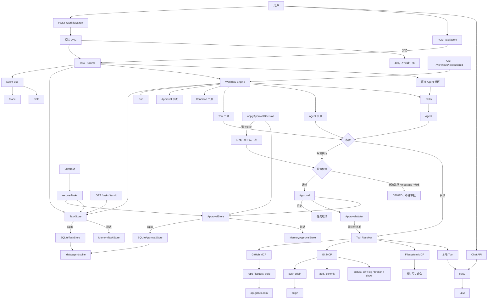

# v1.8.0：持久化审批与任务恢复

## 总述

v1.7.0 在重启时把所有 `waiting` 收成 `failed`，因为审批只活在当时那个进程的 Promise 里。这一版把审批的状态拆出来：`pending` / `approved` / `rejected` 可以写入 `ApprovalStore`，正在等待的 Promise 仍留在本进程。设置 `AGENT_TASK_STORE=sqlite` 和 `AGENT_APPROVAL_STORE=sqlite` 之后，带未决审批的任务会保持 `waiting`。人稍后批准时，如果原进程已经不在，就重新做一次前置校验，再把那一个工具执行恰好一次。不设这两个变量时，任务和审批仍在内存里，重启后和上一版一样丢。



对话、Git、GitHub 和 Trace 都还在。审批不再只有一条内存 Promise：状态进 Store，唤醒仍靠本进程的 Waiter。两边都持久化时，重启后的批准走恢复路径，而不是把原来的模型循环接着跑。

### 从 v1.7.0 转变了什么

保留：

- `running` 在重启后仍收成 `failed`，不重新调用模型，也不把已经跑过的工具再跑一遍。
- 前置校验仍在创建审批之前。恢复执行时会再跑一次，批准不能绕过它。
- 任务和审批默认都是内存实现。只打开其中一个时，重启后等审批的任务无法真正恢复：任务丢了，或者审批丢了从而被收成 `failed`。
- Trace 仍不进 SQLite。工作流执行图也还在内存里。

改变：

- 有未决审批的 `waiting` 保持等待，并发 `task.recovered`（原因 `approval_waiting`）。没有未决审批的 `waiting` 仍收成 `failed`。
- 批准和拒绝都从 `applyApprovalDecision` 进入。同一次审批在 Store 里只能从 `pending` 变成终态一次，重复请求不再执行工具。
- `approval.approved` / `approval.rejected` 只由这个入口发出，权限门里不再发第二次。

新增：

- `ApprovalStore`：`create`、`get`、`resolve`、按任务列出。`resolve` 在 SQLite 里用事务完成，非 `pending` 返回空。
- `SQLiteApprovalStore` 和任务共用 `AGENT_TASK_DB_PATH`（默认 `.data/agent.sqlite`），表是 `agent_approvals`。选择开关是 `AGENT_APPROVAL_STORE=sqlite`。
- `ApprovalWaiter` 只登记当前进程里正在等待的 Promise。进程还在时，批准会唤醒它，由原来的循环继续。
- 进程已经不在时，批准会调用 `resumeApprovedTool`：再校验一次，然后只执行这一个工具，任务记为完成。拒绝则把仍在 `waiting` 的任务取消。
- 找不到可执行工具时（例如工作流里的审批节点）在改状态之前就失败，错误码 `RESUME_UNSUPPORTED`，不会发出 `tool.started`。校验不通过则是 `RESUME_DENIED`。
- `pnpm approval:persistence:evaluate`，用例在 `data/approval-persistence-evaluation.json`，包含跨进程批准后只执行一次。

### 这一版还没有

- 重启后接着原来的模型对话。恢复只补上被批准的那一个工具，然后结束任务。
- 把工作流的节点进度恢复出来。工作流审批不能跨进程继续。
- 自动批准。人必须再次调用审批接口。
- 多实例同时写同一份 SQLite。

## 工作流

1. 需要审批的工具先过前置校验。通过后把 `pending` 写入 `ApprovalStore`，并在本进程登记 Waiter，任务进入 `waiting`。
2. 同一进程里批准或拒绝时，`resolve` 先落状态，再唤醒 Waiter。原来的循环继续执行工具，或把任务取消。
3. 进程重启后，`recoverTasks` 把 `running` 收成 `failed`。`waiting` 若还能查到 `pending` 审批就留着，否则收成 `failed`。
4. 之后人再批准：Store 里没有 Waiter，于是走恢复。再次校验输入，通过后只执行该工具一次，任务完成。
5. 同一次审批已经不是 `pending` 时，再次批准或拒绝直接返回，不再执行。
6. 拒绝一个重启后仍在等待的任务，只把它从 `waiting` 取消，不跑工具。

## 分层

```text
applyApprovalDecision
  → ApprovalStore（状态）
      → MemoryApprovalStore（默认）
      → SQLiteApprovalStore（AGENT_APPROVAL_STORE=sqlite，与任务同一个库）
  → ApprovalWaiter（仅本进程）
  → 无 Waiter 时 resumeApprovedTool
      → preApprovalGuard
      → 执行这一个工具
```

| 层 | 职责 | 位置 |
| --- | --- | --- |
| 审批状态 | 持久化 pending / approved / rejected，保证只解析一次 | `src/lib/agent/approval/` |
| 等待者 | 本进程内唤醒正在等待的执行 | `src/lib/agent/approval/waiter.ts` |
| 决策与恢复执行 | 同进程唤醒，或重启后只执行被批准的工具一次 | `src/lib/agent/task/runtime.ts` |
| 启动恢复 | running 收成 failed；有未决审批的 waiting 留下 | `src/lib/agent/task/recovery.ts` |
