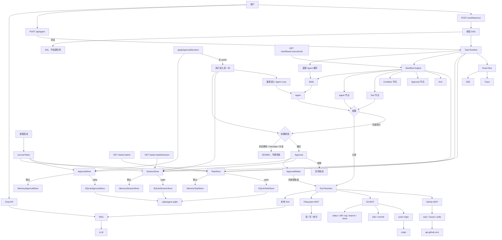

# v1.9.0：Agent Session 与完整恢复

## 总述

v1.8.0 在重启后只能把已经批准的那一个工具再执行一次，然后任务就结束。对话历史还在原来的进程里，模型没法接着想下一步。这一版给每个任务配一份 1:1 的 Session：用户消息、助手回答、工具结果，以及正在等待审批的那次调用。设置 `AGENT_TASK_STORE=sqlite`、`AGENT_APPROVAL_STORE=sqlite` 和 `AGENT_SESSION_STORE=sqlite` 之后，三者写进同一个 `.data/agent.sqlite`。重启后若仍有未决审批，任务保持 `waiting`。人再批准时，先执行这一个工具，再把结果写回 Session，然后用同一套 Agent Loop 重新推理。三个开关缺一个，跨进程恢复就不完整。默认仍全是内存。



对话、Git、GitHub、审批和 Trace 都还在。新的是 Session：它只负责恢复 Agent Loop 所需的历史，不代替任务状态机，也不保存文件正文。

### 从 v1.8.0 转变了什么

保留：

- `running` 在重启后仍收成 `failed`，不会从模型调用中间接着跑。
- 有未决审批的 `waiting` 保持等待；没有未决审批的收成 `failed`。
- 同一次审批仍只能解析一次。恢复执行前仍会再跑前置校验。
- 工作流审批节点仍不能跨进程恢复，错误码是 `RESUME_UNSUPPORTED`。
- Trace 仍不进 SQLite。

改变：

- 创建任务时同时创建一份 Session，并写入脱敏后的初始用户消息。任务进入 `running`、`waiting`、`completed`、`failed`、`cancelled` 时，Session 状态跟着变。
- 重启后的批准不再执行完工具就结束。工具结果追加进 Session 之后，用同一套 Agent Loop 再推理。模型可以再要下一个工具，于是再次进入 `waiting`；也可以直接给出最终回答。
- 校验失败的错误码改成 `RESUME_GUARD_DENIED`。

新增：

- `SessionStore`：会话、按序号递增的消息、以及每个审批对应的一条 pending action。开关是 `AGENT_SESSION_STORE=sqlite`，库路径仍是 `AGENT_TASK_DB_PATH`。
- 表是 `agent_sessions`（`task_id` 唯一）、`agent_session_messages`、`agent_session_pending_actions`（`approval_id` 唯一）。
- `GET /api/agent/tasks/:taskId/session` 返回脱敏后的历史；`/session/summary` 返回条数和当前等待的工具、审批 id。
- 消息在写入前屏蔽看起来像凭证的行。`writeFile` 的正文不进 Session，只留路径和长度；真正执行时仍从 ApprovalStore 里已保存的输入读取。
- `setAgentLoopRunner` 让评测换掉模型调用。生产和恢复默认都是 `streamAgent`，不是另一套循环。
- `pnpm session:persistence:evaluate`，用例在 `data/session-persistence-evaluation.json`，包含跨进程恢复后重新进入循环。

### 这一版还没有

- 恢复一个没有停在审批上的 `running` 任务。那种任务仍直接失败。
- 把工作流执行图恢复出来。
- 在 Session 里保存 `writeFile` 的文件正文。
- 多实例共享同一份 SQLite。

## 工作流

1. `createAndStartTask` 创建任务和 Session，把用户消息脱敏后按顺序写入。
2. Agent Loop 需要审批时，先做前置校验，再把审批状态和一条 pending action 分别写入 ApprovalStore 与 Session，任务和 Session 都变成 `waiting`。
3. 同一进程内批准仍唤醒 Waiter，原来的循环继续。
4. 进程重启后，`recoverTasks` 把 `running` 和没有未决审批的 `waiting` 收成 `failed`，并同步 Session。有未决审批的保持 `waiting`。
5. 人再批准且本进程没有 Waiter：重新校验，执行这一个工具一次，把工具调用和脱敏后的结果追加进 Session，然后用 Session 里的全部消息重新进入 Agent Loop。
6. 循环若再请求需要审批的工具，会再次停下等待。给出最终回答则把回答写入 Session，任务完成。

## 分层

```text
Task Runtime
  → SessionStore（AGENT_SESSION_STORE）
      → MemorySessionStore（默认）
      → SQLiteSessionStore（与任务、审批同一个库）
  → 重启后无 Waiter
      → preApprovalGuard
      → 执行被批准的工具一次
      → 结果写回 Session
      → 同一个 Agent Loop
```

| 层 | 职责 | 位置 |
| --- | --- | --- |
| 会话模型 | 消息、待审批动作，以及写入前脱敏 | `src/lib/agent/session/types.ts` |
| 存储 | 内存或 SQLite；一个任务一份会话 | `src/lib/agent/session/` |
| 恢复执行 | 执行已批准工具后重新进入 Agent Loop | `src/lib/agent/task/runtime.ts` |
| 查询 | 脱敏后的历史和摘要 | `src/app/api/agent/tasks/[taskId]/session/` |
