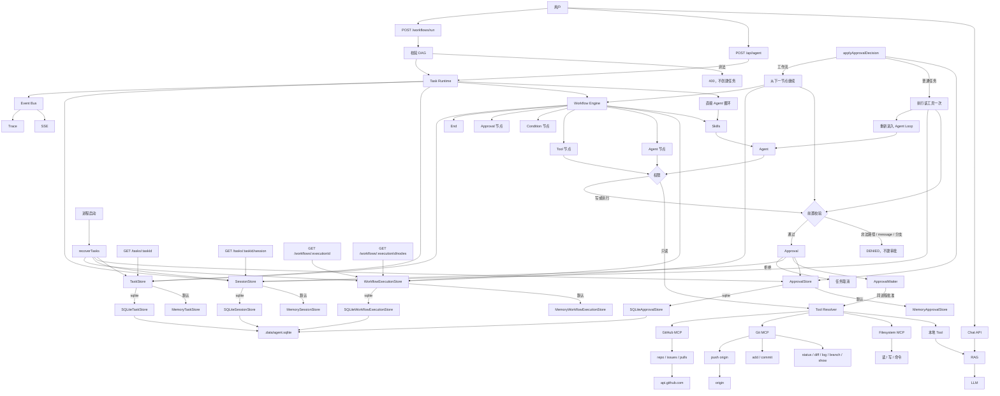

# v1.10.0：工作流执行持久化

## 总述

v1.9.0 能跨进程接着跑的是普通 Agent 任务。工作流的图、当前节点和上下文还在内存里，进程一停就丢。这一版把一次工作流执行收进 `WorkflowExecutionStore`：执行状态、每个节点的状态、上下文，以及当时的工作流定义。设置 `AGENT_WORKFLOW_EXECUTION_STORE=sqlite` 后，它们和任务、审批写进同一个 `.data/agent.sqlite`。这个开关独立于 `AGENT_TASK_STORE`。默认仍是内存。

重启时，正在跑的工作流收成 `failed`，不会从未知的副作用中间重跑。停在未决审批上的工作流保持 `waiting`。人再批准后，重新校验并执行那一个工具一次，然后从下一个节点继续有向无环图。已经完成的节点和已经算过的条件分支不会再执行。工作流里面的 Agent 节点没有可恢复的会话，跨进程时直接失败。



同一进程里等人批准的行为没有变。变的是进程不在之后：普通任务仍走 Session，重新进入 Agent Loop；工作流任务改走 `resumeWorkflowExecution`，从停下的节点后面继续图。

### 从 v1.9.0 转变了什么

保留：

- 普通任务的 Session 恢复不变：执行已批准的工具一次，再重新进入 Agent Loop。
- 工作流里正在跑、但没有停在审批上的执行，重启后收成 `failed`，不自动重跑。
- 同一次审批仍只能解析一次。恢复工具节点前仍会再跑前置校验。
- Trace 仍不进 SQLite。同一进程内的审批等待方式不变。

改变：

- 引擎每走完一个节点，就把节点状态和上下文写入 `WorkflowExecutionStore`。查询执行不再读模块里的 Map。
- `applyApprovalDecision` 认出工作流任务后，批准走 `resumeWorkflowExecution`，拒绝走 `rejectWorkflowExecution`。
- 启动恢复先扫工作流执行。这些任务不再被普通任务的恢复逻辑处理第二次。

新增：

- 节点记录：`pending` / `running` / `waiting` / `completed` / `failed`，以及结果、关联的审批 id、条件分支和尝试次数。
- 表是 `agent_workflow_executions` 和 `agent_workflow_node_executions`。定义、上下文和结果以 JSON 文本保存。节点结果先经过 `sanitizeToolOutput`。审批的原始输入仍只放在 ApprovalStore。
- 恢复时已完成的节点和已经算出的条件分支跳过。工具节点重新校验后执行一次，再把引擎从下一个节点跑下去。
- 工作流中的 Agent 节点跨进程恢复会得到 `RESUME_UNSUPPORTED`，在改状态和发出 `tool.started` 之前失败。
- `GET /api/agent/workflows/:executionId/nodes`。响应里的执行查询不返回整份工作流定义。
- `pnpm workflow:persistence:evaluate`，用例在 `data/workflow-persistence-evaluation.json`，包含跨进程从下一节点继续。

### 这一版还没有

- 恢复工作流里面正在调用模型的 Agent 节点。
- 把一个已经在跑、但没有审批的节点从中途接上。那种执行直接失败。
- 多实例同时写同一份 SQLite。

要让一次停在工具审批上的工作流跨进程继续，需要同时打开 `AGENT_TASK_STORE`、`AGENT_APPROVAL_STORE` 和 `AGENT_WORKFLOW_EXECUTION_STORE`。只打开工作流存储时，任务或审批会在重启后丢失，恢复会把它收成失败。

## 工作流

1. `POST /workflows/run` 校验有向无环图后创建任务和执行记录，定义一起写入 Store。
2. 引擎每进入、完成或失败一个节点，都更新节点记录，并把当时的上下文写回执行记录。
3. 工具节点需要审批时，执行和对应节点进入 `waiting`，审批写入 ApprovalStore。同一进程内批准仍唤醒原来的等待。
4. 进程重启后，`running` 的工作流执行收成 `failed`。`waiting` 且能找到未决审批的保持等待；找不到的收成 `failed`。
5. 人再批准：若停下的是工具节点，重新校验并执行一次，把脱敏结果放进上下文，然后从下一条边继续。已完成节点不再执行。
6. 若停下的是 Agent 节点，直接以 `RESUME_UNSUPPORTED` 失败，不调用模型，也不发工具开始事件。

## 分层

```text
Workflow Engine
  → WorkflowExecutionStore（AGENT_WORKFLOW_EXECUTION_STORE）
      → MemoryWorkflowExecutionStore（默认）
      → SQLiteWorkflowExecutionStore（与任务同一个库）
  → 重启后批准工具节点
      → preApprovalGuard
      → 执行该工具一次
      → 从下一个节点继续 DAG
```

| 层 | 职责 | 位置 |
| --- | --- | --- |
| 执行存储 | 执行、节点、上下文和定义 | `src/lib/agent/workflow/execution-store.ts` |
| SQLite | 两张表，WAL | `src/lib/agent/workflow/sqlite-execution-store.ts` |
| 恢复继续 | 跳过已完成节点，从下一节点跑 | `src/lib/agent/workflow/run.ts` |
| 启动扫描 | running 失败；有审批的 waiting 留下 | `src/lib/agent/task/recovery.ts` |
| 查询 | 执行状态和各节点状态 | `src/app/api/agent/workflows/[executionId]/` |
