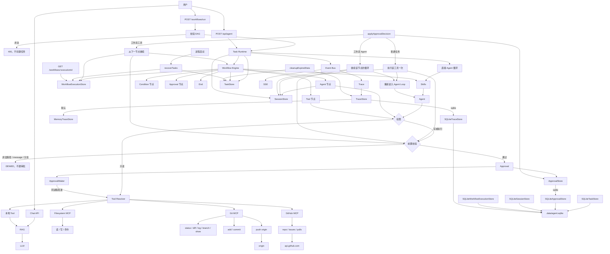

# v1.11.0：Agent 节点恢复、Trace 落盘与过期清理

## 总述

v1.10.0 能跨进程继续的工作流节点只有工具节点。工作流里的 Agent 节点没有会话，重启后直接失败。Trace 也还在内存里。这一版做三件事：工作流的 Agent 节点复用任务上的 Session，批准后重新进入同一个 Agent Loop，答完再继续后面的图；Trace 可以写入 SQLite，恢复时接着记同一次追踪；另外提供一个按天数清理终态数据的函数。三个能力各自有开关，默认都仍是内存，清理也不会自己定时跑。



普通任务的恢复路径还在。工作流多了一条：Agent 节点不再标成不支持，而是执行已批准的工具，把结果写进 Session，再跑同一个循环。循环给出最终回答后，节点才算完成，引擎从下一个节点继续。

### 从 v1.10.0 转变了什么

保留：

- 工作流工具节点的恢复不变：重新校验，执行一次，跳过已完成节点，从下一节点继续。
- `running` 且没有停在审批上的执行，重启后仍收成 `failed`。
- 同一次审批仍只能解析一次。恢复前仍会再跑前置校验和工具解析。
- 清理不会自己按时钟执行。要调用 `cleanupExpiredData()`。

改变：

- 创建工作流任务时同时创建一份 Session。Agent 节点把指令写入这份 Session，并用可替换的 Agent Loop 执行，不再直接调用另一套 `streamAgent`。
- `resumeWorkflowExecution` 遇到 Agent 节点时，改走 `executeApprovedToolToSession`，然后 `continueAgentNode`。模型还可以再要工具，节点会再次等待；只有给出最终回答才完成该节点并继续图。
- Trace 收集器每次事件后把整份 Trace 写回 `TraceStore`。跨进程批准前会 `resumeTrace`，让新事件接在原来的序号后面。

新增：

- `TraceStore`。`AGENT_TRACE_STORE=sqlite` 时写入 `agent_traces` 和 `agent_trace_steps`，路径仍是 `AGENT_TASK_DB_PATH`。写入前再做一次凭证脱敏。
- `cleanupExpiredData()`。默认保留 7 天，可用 `AGENT_PERSISTENCE_TTL_DAYS` 改成正整数。只删 `completed` / `failed` / `cancelled` 且超过期限的任务，以及更早的终态 Trace。`running`、`waiting`、未决审批、未结束的工作流、仍在 `active` 或 `waiting` 的 Session 都留下。
- `pnpm workflow:agent-resume:evaluate`、`pnpm trace:persistence:evaluate`、`pnpm persistence:cleanup:evaluate`。

### 这一版还没有

- 把没有停在审批上的 `running` 节点从中途接上。
- 定时任务或启动时自动清理。不调用清理函数，数据就一直留着。
- 多实例同时写同一份 SQLite。

工作流 Agent 节点要跨进程继续，需要同时打开任务、审批、Session 和工作流执行这四个存储。Trace 要在重启后还能接着看，再打开 `AGENT_TRACE_STORE`。

## 工作流

1. 工作流任务创建时带上一份 Session。Agent 节点把本步指令追加进去，然后跑 Agent Loop。
2. 循环要审批时，节点和执行进入 `waiting`，审批和 pending action 分别落库。Trace 在每个事件后更新快照。
3. 重启后，没有停在审批上的执行收成 `failed`。停在未决审批上的留下。
4. 人再批准 Agent 节点：新进程先挂上原来的 Trace，重新校验并执行那一个工具，结果写入 Session，然后继续这个节点的循环。
5. 循环结束并给出回答后，节点记为完成，引擎从下一条边继续。已完成的节点不重跑。
6. 需要清理时调用 `cleanupExpiredData()`。它按任务的 `updatedAt` 和 TTL 判断，关联的 Trace、Session、审批、工作流执行和任务事件一起删。关联数据仍在等待时，这条任务跳过。

## 分层

```text
Workflow Agent 节点
  → SessionStore
  → 同一个 Agent Loop
  → 重启后 executeApprovedToolToSession
      → 继续该节点，答完再继续 DAG

Trace Collector
  → TraceStore（AGENT_TRACE_STORE，默认内存）

cleanupExpiredData（AGENT_PERSISTENCE_TTL_DAYS，默认 7，需主动调用）
  → 终态且过期的 Task / Session / Approval / Workflow / Trace
```

| 层 | 职责 | 位置 |
| --- | --- | --- |
| Agent 节点恢复 | 执行已批准工具后继续该节点的循环 | `src/lib/agent/workflow/run.ts` |
| 共享执行 | 重新校验并只执行一次，结果写入 Session | `src/lib/agent/task/runtime.ts` |
| Trace 存储 | 内存或 SQLite；恢复时接上序号 | `src/lib/agent/trace/` |
| 清理 | 只删过期的终态数据 | `src/lib/agent/persistence/cleanup.ts` |
