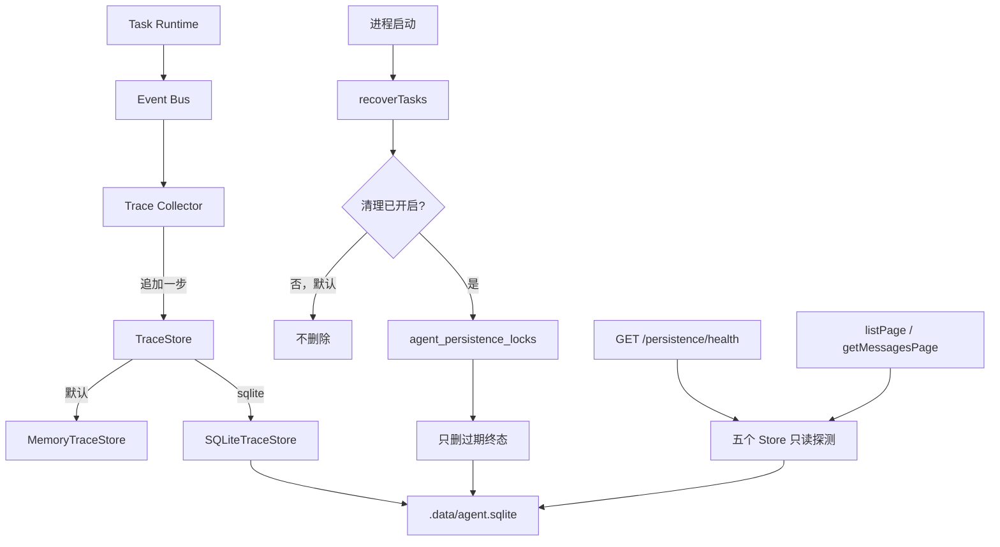

# v1.12.0：持久化可靠性

## 总述

v1.11.0 每次事件都把整份 Trace 重写一遍，清理也只能手动调用。这一版把 Trace 改成按步骤追加：每一步单独写入，序号在 SQLite 事务里递增，同一步骤重复写不会再插一条。进程启动时可以顺带清理过期的终态数据，但默认关闭。任务、工作流、Trace 和会话消息可以按游标分页读取。`GET /api/agent/persistence/health` 只报告各存储是否可用，不改数据，也不返回完整路径或密钥。



对话、审批、工作流恢复都还在。变的是持久化怎么写、怎么读、以及什么时候可以删。

### 从 v1.11.0 转变了什么

保留：

- 各 Store 默认仍是内存。SQLite 仍共用 `AGENT_TASK_DB_PATH`。
- 恢复仍不重跑没有停在审批上的 `running` 任务。
- 清理仍只删 `completed` / `failed` / `cancelled` 且超过 TTL 的数据。未决审批、正在跑的工作流、`active` 或 `waiting` 的 Session 会留下。
- 恢复执行时仍读取完整的消息历史，不走分页。

改变：

- Trace 收集器不再每次把整份记录重写进库。一步的打开和关闭各自 `appendStep`。`stepId` 相同则视为同一步，不另起序号。`resumeTrace` 继续原来的 `traceId`，序号从已保存的最大值往后加。
- `putTrace` 还在，只作为兼容入口。

新增：

- `AGENT_PERSISTENCE_CLEANUP_ENABLED`，默认不是 `true`。设成 `true` 后，`initializeAgentRuntime` 在恢复之后调用 `cleanupExpiredData({ lock: true })`。锁在表 `agent_persistence_locks` 里。另一个进程拿着锁时，这次跳过并打日志，不会删两遍。清理失败不会让应用起不来。TTL 仍是 `AGENT_PERSISTENCE_TTL_DAYS`，默认 7。
- `listPage`：任务、工作流执行、Trace。`getMessagesPage`：会话消息。默认 20 条，最多 100 条。游标是 base64url 的 JSON，非法游标抛 `InvalidCursorError`。任务、执行和 Trace 按时间与 id 倒序；消息按 sequence 正序。原来的 `list()` 和 `getMessages()` 仍返回全部。
- Trace 的 SQLite 写入使用 `BEGIN IMMEDIATE`，失败回滚。数据库忙时最多重试 3 次。
- `GET /api/agent/persistence/health` 返回五个存储的后端类型、是否可读、schema 是否就绪，以及清理是否开启和 TTL。SQLite 只给出文件名，不给出目录。

### 这一版还没有

- 默认开启启动清理。升级后不会自动删历史数据。
- 用分页接口恢复 Agent Loop。恢复仍读全量消息。
- 把健康检查接成外部监控或告警。
- 多实例同时写同一份 SQLite 时，除清理锁和 Trace 的有限重试之外，没有更完整的协调。

## 工作流

1. 每个 Trace 事件先脱敏，再追加一步。序号在事务里取 `MAX(sequence)+1`。进程重启后的恢复事件追加到同一条 Trace。
2. 进程启动先做任务恢复。只有显式打开清理开关时，才尝试拿锁并删除过期终态数据。
3. 列表接口按游标翻页。调用方拿不到下一页游标时，说明这一页已经是最后一页。
4. 健康检查对每个 Store 做一次最小读取。读失败时该项标成不可用，不抛到请求外面变成未处理异常。

## 分层

```text
Trace Collector
  → appendStep / updateSummary
      → TraceStore

initializeAgentRuntime
  → recoverTasks
  → 仅当 AGENT_PERSISTENCE_CLEANUP_ENABLED=true
      → cleanupExpiredData({ lock: true })

GET /api/agent/persistence/health
  → 只读探测 Task / Approval / Session / Workflow / Trace
```

| 层 | 职责 | 位置 |
| --- | --- | --- |
| 增量 Trace | 按步骤写入，序号不重复 | `src/lib/agent/trace/` |
| 清理触发 | 默认关闭；开启后启动时加锁清理 | `src/lib/agent/persistence/cleanup.ts`、`src/lib/agent/task/recovery.ts` |
| 分页 | 游标与条数上限 | `src/lib/agent/persistence/pagination.ts` |
| SQLite 事务 | 忙时有限重试，失败回滚 | `src/lib/agent/persistence/sqlite-util.ts` |
| 健康检查 | 只读诊断 | `src/app/api/agent/persistence/health/route.ts` |
