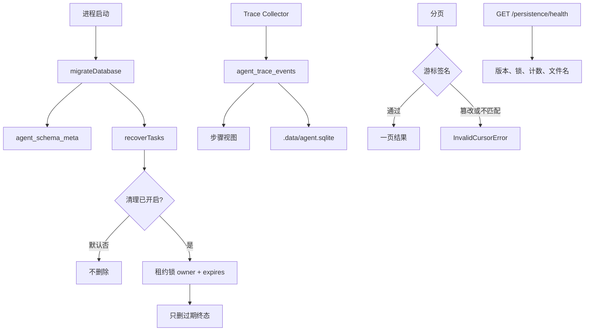

# v1.13.0：持久化加固

## 总述

v1.12.0 的 Trace 按步骤追加，但步骤仍是直接写进去的结果，库表也没有单独的版本。这一版把 Trace 的事实来源改成只追加的事件日志，步骤从事件推导。SQLite 在启动时按 schema 版本迁移，当前到第 3 版，和 `package.json` 的版本无关。分页游标带上 HMAC，对不上就拒绝，不会退回全表扫描。清理锁带上持有者和过期时间，长清理会续约，过期后别的进程才能接过。



任务恢复、审批和工作流继续的规则没有变。变的是库怎么升级、Trace 怎么记，以及分页和清理锁怎么防错。

### 从 v1.12.0 转变了什么

保留：

- 各存储默认仍是内存。清理默认关闭，仍只删过期的终态数据。
- 恢复仍读全量消息，不靠分页游标把对话接回去。
- 健康检查仍不返回密钥和完整数据库路径。

改变：

- Trace 收集器每收到一条任务事件，就往 `agent_trace_events` 追加一条。`(trace_id, event_id)` 重复则不再插入。步骤表还在，但是推导出来的视图。跨进程恢复继续同一条 Trace，序号由 SQLite 接着排。
- 分页游标从单纯的 base64 变成 `payload.HMAC-SHA256`。签名不对、资源类型不对、版本不对或格式坏了，都抛 `InvalidCursorError`，不会当成第一页或全量。
- 清理锁增加 `owner_id` 和 `expires_at`。清理过程中续约。只有持有者能释放。租约过期后，另一个进程可以拿走。

新增：

- `agent_schema_meta` 和 `agent_schema_migrations`。迁移依次是：登记 v1.12 的基线、创建事件日志、给清理锁加列。每一步在事务里做，失败回滚。启动时只要有一个存储选了 sqlite，并且设置了 `AGENT_TASK_DB_PATH`，就会跑迁移。没设路径时，各存储仍按默认文件懒创建自己的表。
- 游标密钥用 `AGENT_PERSISTENCE_CURSOR_SECRET`。没设时本地开发用一个固定回退值，这个值不进数据库、日志和接口。健康检查只报告是否配置了环境变量。
- 进程内计数：任务创建、Trace 追加、清理删了多少、跳过多少。计数不写入 SQLite，健康检查带一份当前进程的快照。
- `AGENT_PERSISTENCE_TEST_FAILURE` 默认关闭，只给评测注入回滚。
- `pnpm persistence:hardening:evaluate`。

### 这一版还没有

- 未设置 `AGENT_TASK_DB_PATH` 时，启动迁移不会跑。默认路径上的库仍靠各存储自己建表。
- 把进程内计数做成跨进程或持久的监控。
- 用签名游标恢复 Agent Loop。

## 工作流

1. 进程启动时，若使用 SQLite 且配置了数据库路径，先把 schema 迁到第 3 版，再做任务恢复。迁移失败只打日志，不让应用起不来。
2. 每个任务事件脱敏后追加进事件日志。同一次事件重复到达时，唯一约束挡住第二行。步骤从这些事件更新。
3. 翻页时校验游标签名和资源名。任务列表的游标不能拿去翻会话消息。
4. 打开清理后，进程先拿租约。清理时间长就续约。别的进程看到未过期的租约就跳过。结束后只有持有者删除这把锁。

## 分层

```text
initializeAgentRuntime
  → migrateDatabase（schema 版本，不是包版本）
  → recoverTasks
  → 清理（默认关；租约锁）

Trace Collector
  → appendTraceEvent（只追加，事实来源）
  → 步骤视图

分页
  → HMAC 游标，按资源分开
```

| 层 | 职责 | 位置 |
| --- | --- | --- |
| 迁移 | 登记版本，补事件表和清理锁列 | `src/lib/agent/persistence/migrations.ts` |
| 事件日志 | Trace 的只追加事实来源 | `src/lib/agent/trace/` |
| 游标 | 签名、资源范围、拒绝篡改 | `src/lib/agent/persistence/pagination.ts` |
| 租约 | 持有者、过期、续约 | `src/lib/agent/persistence/cleanup.ts` |
| 计数 | 仅当前进程 | `src/lib/agent/persistence/metrics.ts` |
