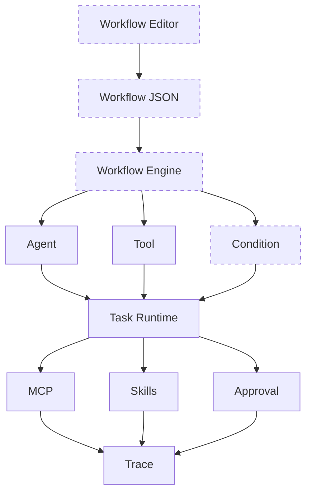

# Agent 架构演进

每一份文档先给这一版的分层，再写相对上一版多了哪一层，最后写工作流。目标结构从上到下是：工作流定义、执行入口、Agent / Tool / Condition、Task Runtime、MCP / Skills / Approval，最底下是 Trace。

虚线是还没有对应代码的层。实线是 v1.0.0 已经有的层。

v0.8.0 之前没有单独版本号，按代码里的阶段命名；从 v0.8.0 起与 CHANGELOG 一致。`/api/chat` 的检索后回答路径一直保留，不在这张图里。

| 文件 | 版本 | 这一版让 Agent 多了什么 |
| --- | --- | --- |
| [00-baseline.md](00-baseline.md) | 基线 | 还没有 Agent。服务端先检索知识库，再让模型回答 |
| [01-agent-loop.md](01-agent-loop.md) | Agent Loop | 模型自己决定要不要调用工具，并可以连续多步 |
| [02-task-runtime.md](02-task-runtime.md) | Task Runtime | 一次执行变成可查询的任务，有明确状态 |
| [03-v0.8.0.md](03-v0.8.0.md) | v0.8.0 MCP + Skills | 事件流式推出；本地工具和 MCP 统一解析；技能写入系统提示 |
| [04-v0.9.0.md](04-v0.9.0.md) | v0.9.0 Coding Agent | 可以改文件、跑受控命令，但必须先等人批准 |
| [05-v1.0.0.md](05-v1.0.0.md) | v1.0.0 Trace | 任务结束后仍能回看步骤、耗时和评估结果 |
